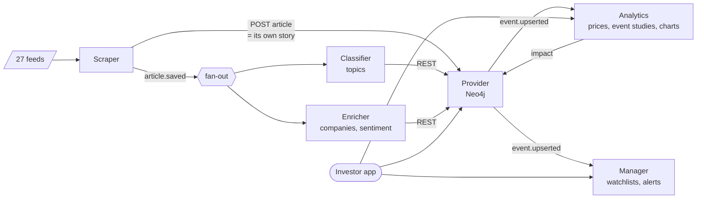
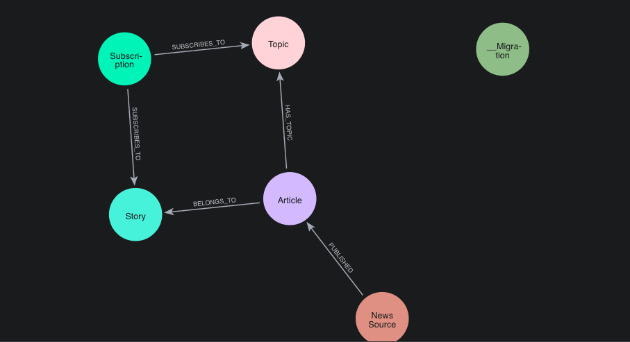
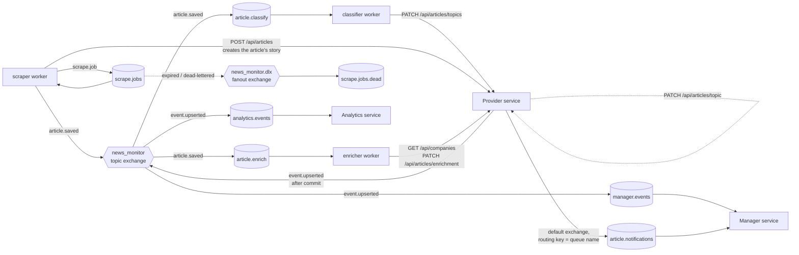

# News Monitor : Complete System Architecture

**News Monitor** is a distributed backend that ingests, classifies and links **banking and fintech news** to companies, turns it into stories and company events, and serves them with market data, chart APIs and ticker alerts to an investor-facing app. It started as a generic news monitor and was transformed in phases (see [`documentation/FINTECH_TRANSFORMATION_PLAN.md`](documentation/FINTECH_TRANSFORMATION_PLAN.md) for the plan and its progress log; all phases are complete). The system has three Spring Boot services (a user-facing **manager**, a data **provider**, and a market **analytics** service) and three Python workers (scraper, classifier, enricher), connected by HTTP and RabbitMQ, each service owning its own datastore. This document is the complete, single source of truth for understanding the entire system.

**Flow diagrams** (pipeline, events, alerts, read paths, auth): [`SYSTEM_FLOW.md`](documentation/SYSTEM_FLOW.md). **API reference:** [`PROVIDER_API.md`](documentation/PROVIDER_API.md), [`MANAGER_API.md`](documentation/MANAGER_API.md), [`CHARTS_API.md`](documentation/CHARTS_API.md).



### Banking / fintech status

| Area | State |
| --- | --- |
| Sources | 27 validated US/UK/EU feeds: trade press, financial news, regulators, central banks ([report](data/source_validation/report.md)). Political-orientation data removed. |
| Topics | 13 banking topics, multi-label with scores: FinBERT fine-tuned on public data + a rule layer for regulator/enforcement content |
| Entities and sentiment | 356 companies (banks, fintechs, regulators, central banks) and 345 tickers. The enricher worker links articles to them, scores FinBERT sentiment per article and per company, and the provider derives Story→Company events with an impact score |
| Watchlists and alerts | Users watch up to 50 tickers with an impact threshold and optional topic filter; the manager turns `event.upserted` into one alert per event and user. The watchlist shows each ticker's latest quote and event from analytics ([MANAGER_API.md](documentation/MANAGER_API.md#watchlistcontroller--apiusersmewatchlist)) |
| Market data and event studies | Spring Boot `analytics` service with its own `market` database: event read model fed by RabbitMQ, daily prices behind a pluggable provider (needs an API key), market-model event studies written back to the provider. Chart APIs: price, event markers, overlay, sentiment, news and topic volume, event-impact paths, sector heatmap, quotes ([CHARTS_API.md](documentation/CHARTS_API.md)); company graph on the provider |

---

## Architecture Evolution

### Phase 1: Java Monolith with Embedded Threads (The Starting Point)

The system began as a single Spring Boot monolith in Java, connected only to PostgreSQL. The pipeline ran as background threads within the same JVM:

- **One process** bundled everything: user accounts, web APIs, news scraping, classification, and clustering.
- **Thread pool** inside the monolith orchestrated the pipeline stages.
- **PostgreSQL only** : everything (users, articles, classifications, clusters) lived in a single relational database.
- **Two simplistic Python workers** existed but were loosely coupled, handling only basic tasks.

**The problem:** As article volume grew, competing workloads fought for resources. A heavy classification task could starve the web server, and a stuck classification thread could block scraping jobs. Scaling was bottlenecked by the monolith's single process boundary.

### Phase 2: Decoupled Worker Types (Breaking Apart the Threads)

The next iteration realized that scraping, classifying, and clustering were fundamentally different workloads:

- **Three dedicated scraping Java workers** replaced the embedded threads, each in its own process.
- **Shallow scraping** (RSS feed only) was still used since Java libraries for web scraping are limited.
- **REST API python workers** are used for classification and embeddings/clustering.

### Phase 3: Specialized Datastores and Workers(From One to Three)

The current design abandons the monolithic database:

- **Python web scraping** : The former java scrapers were converted to python for true web scraping.
- **RabbitMQ** became the communication backbone: jobs flow through queues, decoupling producer from consumer.
- **RabbitMQ clients** : the former REST API python workers were replaced with RabbitMQ consumers in order to allow async computation.
- **One queue per worker type:** `scrape.jobs` => scraper worker, `article.classify` => classifier worker, `article.cluster` => clusterer worker, `article.enrich` => enricher worker.
- **Fan-out pattern:** the scraper publishes one event (`article.saved`), and a topic exchange fans it to both classification and clustering queues, allowing them to run independently.
- **PostgreSQL** (manager) - user accounts, subscriptions, and notifications. High-consistency relational data.
- **Neo4j** (provider) - articles, sources, topics, and stories.
- **Qdrant** (clusterer worker) - one vector collection holding story centroids. Efficient nearest-neighbor search for clustering decisions.

Vectors and structured data have different access patterns. Embedding 384-dim vectors into Neo4j as properties would be both slow and wasteful. Qdrant's ANN index makes "find the closest story" O(log n) instead of O(n), and its specialized hardware support means clustering stays fast as article volume grows.

**The tradeoff:** No FK constraints across databases. Consistency is maintained at the application layer-each service owns its data and validates foreign references via HTTP before trusting them.

*Later removed:* the clusterer worker, Qdrant and its Redis lock (see Phase 4). On the specialised banking sources 92% of the clusterer's stories held a single article, so every article is now its own story and the vector store is gone.

### Phase 4: Banking / Fintech Investor Backend (Current)

The generic monitor was turned into an investor backend ([plan and progress log](documentation/FINTECH_TRANSFORMATION_PLAN.md)):

- **Sources:** 27 validated US/UK/EU banking feeds (trade press, financial news, regulators, central banks); political-orientation data removed.
- **Classifier:** 13 multi-label banking topics, FinBERT fine-tuned on public data only, plus a rule layer.
- **Enricher worker (new):** links articles to 356 companies / 345 tickers and scores FinBERT sentiment; the provider derives Story→Company **events** with an impact score and publishes them as `event.upserted`.
- **Analytics service (new, Spring Boot + Postgres `market`):** event read model, daily prices, market-model event studies, chart APIs.
- **Manager:** ticker watchlists and event alerts.
- **Clustering removed:** with specialised sources almost every story held one article (240 of 262), so the clusterer worker, Qdrant and the Redis lock were removed. The provider gives every saved article its own story, which events, chart markers and alerts still key on (see [Stories](#stories-one-per-article)).

### Why This Architecture

1. **User accounts** are central to auth (manager issues all JWTs), so they can't be distributed. PostgreSQL is ideal.
2. **Articles and stories** form a graph (article => topic, article => story, story => article => source). Neo4j models this naturally, SQL would require many JOINs.
3. **Market time series** (daily prices, event studies) are tabular and range-scanned, so analytics keeps them in its own Postgres database.

---

## System Overview

### Architectural Decisions

**1. One datastore per owner**

- Manager owns user accounts, subscriptions, watchlists and notifications (Postgres `news_monitor`, schema `users`).
- Provider is system-of-record for articles/stories/topics/sources/companies/events (Neo4j).
- Analytics owns prices, the event read model and event studies (Postgres `market`, its own DB user).

**2. Provider = single read/write gateway for all structured data**

- Scraper, classifier and enricher workers never touch Neo4j directly.
- All write operations go through the Provider's REST API, enforcing consistency.
- This is why the Provider is "the news broker".

**3. Async pipeline with RabbitMQ, sync subscription checks**

- **Async:** scraper => classify/enrich workers (via queues). Scraping never waits for classification. Provider => analytics and manager via `event.upserted`.
- **Sync:** user subscribes => manager calls provider to verify the topic exists. If provider is down, the subscription fails immediately with a `502`. The watchlist reads quotes and latest events from analytics with a 2 s timeout and shows `null` for them if analytics is down.

---

## Service Details

### Manager Service (Spring Boot + PostgreSQL)

**Role:** User-facing backend. Only service that issues JWTs. Sole owner of the authentication/authorization model.

**Endpoints:**

- `/api/auth/*` - register, login (email+password for users; `systemCode` for services)
- `/api/users/me/*` - account management (read/write own profile, change password)
- `/api/users/{id}/*` - admin operations (list, create, modify, delete users; grant/revoke roles)
- `/api/users/me/subscriptions/*` - subscribe/unsubscribe to topics (manager-side rows; synced with provider) or tickers
- `/api/users/me/notifications/*` - list, mark-seen, delete personal notifications (article notifications and ticker alerts)
- `/api/users/me/watchlist/*` - watched tickers with alert settings, latest quote and latest event

**Database (PostgreSQL):**

| Table             | Purpose                                                                                                     |
| ----------------- | ----------------------------------------------------------------------------------------------------------- |
| `users`         | email, password (BCrypt), name, enabled flag                                                                |
| `user_roles`    | join table linking users to`ROLE_USER` / `ROLE_ADMIN` / `ROLE_SYSTEM`                                 |
| `subscriptions` | per-user subscriptions to topics/stories, and watched tickers (`TICKER`, with `min_impact` and `topics`) |
| `notifications` | per-user notifications: new articles for subscribed topics/stories, and ticker alerts (only written by RabbitMQ consumers) |
| `ticker_alerts` | one row per (user, story, company) already alerted, so a growing story alerts once                          |
| `roles`         | seed rows for the three role types                                                                          |

**RabbitMQ:**

- **Consumes:** `article.notifications` (an article matched a subscribed topic → `Notification` rows for all interested users) and `manager.events` (`event.upserted` → ticker alerts for users whose threshold and topic filter match).
- **Never publishes** to the worker queues.

**Tests:** `cd backend/manager && mvn test` (9, against the `users` schema of the local Postgres with the provider and analytics mocked; set `SPRING_DATASOURCE_PASSWORD`, `DB_USERNAME`, `DB_NAME` from `.env`): watchlist add/update/remove, quotes and latest event, analytics-down fallback, validation codes, the 50-ticker limit, TICKER through the generic subscriptions endpoint; alerts on threshold crossing, once per event, per-user thresholds and topic filters, deleted/old/unlisted/unwatched events, Neo4j timestamp formats, cascade on user delete.

**Authentication Model:**

- Issues three roles: `ROLE_USER` (human users), `ROLE_ADMIN` (human admins), `ROLE_SYSTEM` (services: manager itself, all workers).
- JWTs are signed with an RSA keypair (`JWT_PRIVATE_KEY_PATH`): manager holds the private key and is the only service that can sign tokens. Provider validates tokens but never issues them, and never has the private key.

---

### Provider Service (Spring Boot + Neo4j)

**Role:** System of record for all structured data (articles, stories, topics, sources, subscriptions). Acts as the single read/write gateway so that consistency is centralized.

**Endpoints:**

- `/api/news-sources/*` - CRUD news sources
- `/api/articles/*` - search, fetch, save articles; tag with topics; trigger scraping
- `/api/stories/*` - read stories (one per article, created when the article is saved)
- `/api/topics/*` - list all topics, check topic exists
- `/api/companies` - the company universe with tickers; `/api/companies/{symbol}/graph` - company ↔ story network
- `/api/events` - Story→Company events (paged feed for rebuilding read models); `PATCH /api/events/{storyId}/{companyId}/impact` - event-study write-back from analytics
- `PATCH /api/articles/enrichment` - sentiment and company mentions from the enricher (refreshes the story's events)
- `/api/subscriptions/story/{id}` or `/topic/{name}` - track that *someone* is interested (not which user-that's manager's job)

**Database (Neo4j):**



Graph structure (banking/fintech model):

| Node           | Key properties                                                          | Written by                                                       |
| -------------- | ----------------------------------------------------------------------- | ---------------------------------------------------------------- |
| `NewsSource` | name, baseUrl, rssUrl, category, region, paywalled, language, scrapeIntervalMinutes, lastScrapeQueuedAt, failureCount, isDisabled | Seeded by migration (generated by `validate_sources.py`), provider admin API, scraper worker (failure count) |
| `Article`    | author, title, url (unique), bodyText, publishedAt, language, sentimentLabel, sentimentScore | Scraper worker; enricher worker (sentiment) |
| `Company`    | name, lei (unique), country, kind (BANK/FINTECH/REGULATOR/CENTRAL_BANK/OTHER), aliases | Seed migration (company universe) |
| `Ticker`     | symbol, exchange ((symbol, exchange) unique), currency | Seed migration |
| `Topic`      | name (unique)                                                           | Classifier worker                                                |
| `Story`      | title, createdAt, lastUpdated, articleCount, sourceCount, trendingScore | Provider, when the article is saved (one story per article)      |

| Relationship                                  | Meaning                                                                     |
| --------------------------------------------- | --------------------------------------------------------------------------- |
| `Article-[PUBLISHED]->NewsSource`           | Article came from this source                                               |
| `Article-[HAS_TOPIC {score}]->Topic`        | Classifier topic (multi-label), with confidence                             |
| `Article-[MENTIONS {count, salience, inTitle, sentiment}]->Company` | Enricher linked a company mention (Cypher-managed) |
| `Story-[AFFECTS {firstSeen, impactScore}]->Company` | Event: a story about a company (Cypher-managed) |
| `Company-[LISTED_AS {primary}]->Ticker`     | Listing used for price charts                                               |
| `Article-[BELONGS_TO]->Story`               | The article's story (created with it)                                       |
| `Subscription-[SUBSCRIBES_TO]->Topic` | Count of active subscriptions to this topic (for notification gating) |

**Authentication:**

- Only validates JWTs (holds manager's RSA public key, never its private key — it can verify signatures but can't forge them).
- All mutating endpoints require `ROLE_ADMIN` or `ROLE_SYSTEM`.
- All read endpoints are public (no auth required).

**RabbitMQ:**

- **Publishes (only):**
  - `scrape.jobs`: triggered by the scheduler (checks every 5 min, queues each enabled source whose own `scrapeIntervalMinutes` has elapsed) or the manual `/api/articles/trigger-scrape` call (all sources).
  - `article.notifications`: published when a subscribed topic gets a new article (triggered by the classifier calling `PATCH /api/articles/topic(s)`).
  - `event.upserted` (on the `news_monitor` exchange, after commit): every created, updated or removed Story→Company event, consumed by analytics (`analytics.events`) and manager (`manager.events`).
- **Never consumes** - only a producer.

---

### Analytics Service (Spring Boot + Postgres `market`)

Market data, event studies and chart APIs; consumes `event.upserted`. See [Analytics Service](#analytics-service-spring-boot--postgres-market).

### Workers (Python)

Three independent processes (scraper, classifier, enricher), each consuming one RabbitMQ queue and reading/writing through the Provider's REST API; all scale horizontally. See [Workers: The Python Processing Pipeline](#workers-the-python-processing-pipeline). Authentication for all services is in [Authentication & Authorization Model](#authentication--authorization-model).

---

## Scaling Considerations

### Horizontal Scaling: Workers

Each worker type is stateless-add as many instances as you need:

```bash
# Run 3 scraper instances (load-balanced over scrape.jobs queue)
make scrape-worker &
make scrape-worker &
make scrape-worker &

# Run 2 classifier instances
make classify-worker &
make classify-worker &

# Run 2 enricher instances
make enrich-worker &
make enrich-worker &
```

RabbitMQ automatically distributes messages among consumers. Scraper instances share the load of all `scrape.jobs`. Classifier and enricher instances handle `article.classify` and `article.enrich` in parallel; writes to one story are serialized by the provider (story lock + retried transactions).

## Message Queue Topology: RabbitMQ

### Diagram



`article.notifications` is deliberately **not** attached to the topic exchange - it's isolated so provider's notification messages never accidentally mix with scraper's article-saved events.

### Exchanges and Queues

| Exchange             | Type   | Durable | Purpose                                                                  |
| -------------------- | ------ | ------- | ------------------------------------------------------------------------ |
| `news_monitor`     | topic  | yes     | Fan-out hub. Scraper publishes `article.saved` (classify/enrich queues); provider publishes `event.upserted` (analytics and manager queues). |
| `news_monitor.dlx` | fanout | yes     | Dead-letter target for`scrape.jobs` (24h TTL messages land here).      |

| Queue                     | Durable | Binding              | Routing key       | Purpose                                                                                                    |
| ------------------------- | ------- | -------------------- | ----------------- | ---------------------------------------------------------------------------------------------------------- |
| `scrape.jobs`           | yes     | `news_monitor`     | `scrape.job`    | Scraper worker consumes; provider/scraper produce. TTL 24h, dead-letters to`news_monitor.dlx`.           |
| `scrape.jobs.dead`      | yes     | `news_monitor.dlx` | `#`             | Dead-lettered messages (inspection/replay only).                                                           |
| `article.classify`      | yes     | `news_monitor`     | `article.saved` | Classifier worker consumes; scraper produces.                                                              |
| `article.enrich`        | yes     | `news_monitor`     | `article.saved` | Enricher worker consumes; scraper produces. |
| `article.notifications` | yes     | (none)               | n/a               | Provider produces; manager consumes.**Not bound to topic exchange** (isolated from scraper fan-out). |
| `analytics.events`      | yes     | `news_monitor`     | `event.upserted`  | Analytics consumes; provider produces when a story-company event changes (after commit). |
| `manager.events`        | yes     | `news_monitor`     | `event.upserted`  | Manager consumes the same events for watchlist alerts. |

### Message Shapes

**`scrape.jobs`** - One per news source per scrape trigger:

```json
{ "name": "banking-dive", "retry_count": 0 }
```

**`article.classify` / `article.enrich`** - Same message, fanned out from `article.saved`:

```json
{ "url": "https://www.bankingdive.com/news/...", "source_name": "banking-dive" }
```

**`analytics.events` / `manager.events`** - Same `event.upserted` message (provider `EventMessage`, Jackson type header `data.provider.dto.messages.EventMessage`):

```json
{ "storyId": "…", "companyId": "…", "companyName": "Citigroup", "symbol": "C", "exchange": "XNYS", "currency": "USD",
  "storyTitle": "…", "firstSeen": "2026-11-13T09:12:00Z", "impactScore": 0.62, "articleCount": 3, "sentiment": -0.41,
  "topics": ["regulation_legal_enforcement"], "deleted": false, "version": 1794560000000 }
```

**`article.notifications`** - Published only when subscription exists:

```json
{ "name": "regulation_legal_enforcement", "articleUrl": "https://...", "type": "TOPIC" }
```

or

```json
{ "name": "Regional lender agrees to acquire rival", "articleUrl": "https://...", "type": "STORY" }
```

### Producer & Consumer Summary

| Queue                     | Producer                                                                | Consumer                                  | Condition                                       |
| ------------------------- | ----------------------------------------------------------------------- | ----------------------------------------- | ----------------------------------------------- |
| `scrape.jobs`           | Provider (5-min due-source scheduler + manual trigger), Scraper (re-queue on failure) | Scraper worker                            | Always                                          |
| `article.classify`      | Scraper (fan-out via topic exchange)                                    | Classifier worker                         | Always, after article saved                     |
| `article.enrich`        | Scraper (fan-out via topic exchange)                                    | Enricher worker                           | Always, after article saved                     |
| `article.notifications` | Provider (`ArticleService`, `StoryService`)                         | Manager (`ArticleNotificationListener`) | Only if subscription exists for the story/topic |
| `analytics.events`      | Provider (`EventService`, after commit)                                | Analytics (`EventListener`)               | Whenever an event is created, updated or removed |
| `manager.events`        | Provider (same messages)                                               | Manager (`EventAlertListener`)            | Alert only if impact ≥ the watcher's threshold, topic filter matches, first seen ≤ 72 h ago, not alerted before |

---

## Databases

### Why Several Databases?

Originally, everything lived in PostgreSQL. This created three problems:

1. **Relational model can't efficiently express graphs.** Storing "article => topic" and "article => story" requires multiple tables and JOINs. Neo4j's graph model maps directly.
2. **Vector similarity search is O(n) in SQL.** Nearest-neighbor queries for story clustering required full table scans; Qdrant's HNSW index made them O(log n). (Clustering and Qdrant were later removed: see [Stories](#stories-one-per-article).)
3. **Different consistency guarantees.** User accounts need strong ACID (PostgreSQL). Article classifications can tolerate eventual consistency (RabbitMQ). Market time series need range scans (analytics' Postgres `market`).

**Solution:** Polyglot persistence. Each service owns a specialized datastore optimized for its job. No FK constraints across databases-consistency lives at the application layer. The analytics service later added a second Postgres database, `market`, on the same server but with its own user, for time series and event studies (see [Analytics Service](#analytics-service-spring-boot--postgres-market)).

### PostgreSQL: Manager's Relational Data

**Database:** `news_monitor` | **Schema:** `users` | **Managed by:** Flyway migrations (`V1`–`V8`; `V7` adds watchlists and alerts, `V8` drops the removed `STORY` subscriptions)

#### `roles`

| Column   | Type               | Notes                                          |
| -------- | ------------------ | ---------------------------------------------- |
| `id`   | SERIAL PK          |                                                |
| `name` | VARCHAR(50) UNIQUE | `ROLE_USER`, `ROLE_ADMIN`, `ROLE_SYSTEM` |

#### `users`

| Column                          | Type                 | Notes                             |
| ------------------------------- | -------------------- | --------------------------------- |
| `id`                          | BIGSERIAL PK         |                                   |
| `email`                       | VARCHAR(255) UNIQUE  | Login identifier                  |
| `password`                    | VARCHAR(255)         | BCrypt hash                       |
| `name`                        | VARCHAR(255)         | nullable                          |
| `enabled`                     | BOOLEAN DEFAULT TRUE | Disabled users can't authenticate |
| `created_at` / `updated_at` | TIMESTAMPTZ          |                                   |

#### `user_roles`

Join table: `(user_id, role_id)` composite PK, both FKs cascade on delete.

#### `subscriptions`

| Column         | Type           | Notes                                          |
| -------------- | -------------- | ---------------------------------------------- |
| `id`         | VARCHAR(36) PK | UUID                                           |
| `user_id`    | BIGINT FK      | CASCADE on delete                              |
| `type`       | VARCHAR(20)    | `TOPIC` or `TICKER`                       |
| `target_id`  | VARCHAR(255)   | Topic name or ticker symbol (no FK: stored in Neo4j) |
| `min_impact` | DOUBLE         | TICKER only: alert threshold (0-1), default 0.5 |
| `topics`     | VARCHAR(1000)  | TICKER only: comma-separated topic filter; null = any topic |
| `created_at` | TIMESTAMPTZ    |                                                |

Unique constraint on `(user_id, type, target_id)` - enforces "can't subscribe twice to the same thing."

#### `notifications`

| Column         | Type                  | Notes                                              |
| -------------- | --------------------- | -------------------------------------------------- |
| `id`         | VARCHAR(36) PK        | UUID                                               |
| `user_id`    | BIGINT FK             | CASCADE on delete                                  |
| `message`    | VARCHAR(1000)         | e.g.,`"New article for TOPIC 'regulation_legal_enforcement': <url>"` |
| `seen`       | BOOLEAN DEFAULT FALSE |                                                    |
| `type`       | VARCHAR(20)           | `ARTICLE` or `TICKER_ALERT`                         |
| `symbol`, `story_id`, `company_id`, `impact_score`, `sentiment` | | Set for `TICKER_ALERT` only |
| `created_at` | TIMESTAMPTZ           |                                                    |

Index on `(user_id, seen)` for unseen-notification queries. Only written by the RabbitMQ consumers (`ArticleNotificationListener`, `EventAlertListener`) - never via HTTP.

#### `ticker_alerts`

Primary key `(user_id, story_id, company_id)`, plus `symbol`, `impact_score`, `created_at`; cascades with the user. Dedup record: an event that keeps being re-published as articles join its story alerts each watcher only once.

### Neo4j: Provider's Graph Data

**Single graph database, no schemas.** Schema and seed data come from Cypher migrations in `backend/neo4j/migrations/`, applied automatically when the container starts:

| Migration | Content |
| --- | --- |
| `V1__baseline_schema` | Constraints and indexes (squashed from the old generic-news V1–V9) |
| `V2__seed_banking_sources` | 27 validated sources (generated by `scraper/tools/validate_sources.py`) |
| `V3__company_ticker_schema` | Company / Ticker / Story constraints, company-name fulltext index, AFFECTS indexes |
| `V4__seed_banking_topics` | The 13 banking topics (must match `classifier/training/taxonomy.py`) |
| `V5__seed_company_universe` | 356 companies and 345 tickers (generated by `enricher/tools/build_universe.py`) |
| `V6__drop_issuer_entities` | Removes SEC filers that are subsidiaries/note issuers of curated companies (seeded by an earlier V5 build; no-op on fresh databases) |
| `V7__one_story_per_article` | Clustering removed: drops story subscriptions and gives any article without a story its own |

#### Nodes

| Label            | Key properties                                                          | Constraints                                                                                              |
| ---------------- | ----------------------------------------------------------------------- | -------------------------------------------------------------------------------------------------------- |
| `NewsSource`   | name, baseUrl, rssUrl, category, region, paywalled, language, scrapeIntervalMinutes, lastScrapeQueuedAt, failureCount, isDisabled | `name` UNIQUE, `rssUrl` UNIQUE, index on `baseUrl` |
| `Article`      | author, title, url, bodyText, publishedAt, language, sentimentLabel, sentimentScore | `url` UNIQUE, indexes on `publishedAt`/`author`/`title`, fulltext index on `[title, bodyText]` |
| `Topic`        | name                                                                    | `name` UNIQUE                                                                                          |
| `Story`        | title, createdAt, lastUpdated, articleCount, sourceCount, trendingScore | `id` UNIQUE, index on `lastUpdated`, fulltext index on `[title]` |
| `Company`      | name, lei, country, kind, aliases | `id` UNIQUE, `lei` UNIQUE, indexes on `name`/`kind`, fulltext index on `[name, aliases]` |
| `Ticker`       | symbol, exchange, currency | `(symbol, exchange)` UNIQUE, index on `symbol` |
| `Subscription` | count                                                                   | Existence checked via relationship (no unique properties)                                                |

**Every node's `id` is an app-generated UUID string** (via `UuidStringIdGenerator`), persisted as a real property. This matters: Spring Data Neo4j's default ID generator only tracks Neo4j's internal element ID, which breaks custom Cypher that matches on `{id: $x}`. Without it, story attachment would silently fail because there's no `id` property to match.

#### Relationships

```
(:NewsSource)-[:PUBLISHED]->(:Article)
(:Article)-[:HAS_TOPIC {score}]->(:Topic)                         // multi-label
(:Article)-[:BELONGS_TO]->(:Story)
(:Article)-[:MENTIONS {count, salience, inTitle, sentiment}]->(:Company)   // Cypher-managed
(:Story)-[:AFFECTS {firstSeen, impactScore}]->(:Company)                   // Cypher-managed
(:Company)-[:LISTED_AS {primary}]->(:Ticker)
(:Subscription)-[:SUBSCRIBES_TO]->(:Topic)
```

A `Subscription` node tracks "someone is interested in this"-it has no link to *which* user, only a `count`. Per-user identity lives in manager's Postgres `subscriptions` table. Provider only needs to know whether to publish a notification (boolean).

### Cross-Database References (By Convention)

No enforced foreign keys; each string agreement is application-level:

| Value          | Source               | Referenced in                                                                                  |
| -------------- | -------------------- | ---------------------------------------------------------------------------------------------- |
| Topic name     | Neo4j`Topic.name`  | Postgres`subscriptions.target_id`                                                            |
| Story`id`    | Neo4j`Story.id`    | `event.upserted`, Postgres `market.events`, `ticker_alerts`                                  |
| Article`url` | Neo4j`Article.url` | Worker messages (`article.classify`/`article.enrich` payloads), `article.notifications` |
| Company `id`, Story `id` | Neo4j `AFFECTS` endpoints | `event.upserted`; Postgres `market.events`, `market.event_impact`; Postgres `ticker_alerts`, `notifications` |
| Ticker symbol (+ MIC) | Neo4j `Ticker` | Postgres `subscriptions.target_id` (TICKER), `market.prices_daily`, chart URLs |

**Consistency failure is soft:** if a manager subscription points to a deleted story, provider's `existsByStoryId` returns `false` and no notification is published. No database error.

---

## Analytics Service (Spring Boot + Postgres `market`)

**Location:** `backend/analytics/` | **Port:** 8090, context path `/analytics` | **Run:** `cd backend/analytics && mvn spring-boot:run` (or the `analytics` compose service)

A separate microservice for market data and the chart APIs ([CHARTS_API.md](documentation/CHARTS_API.md)). It owns the `market` database (same Postgres server, its own `analytics` user with no access to the manager's database; schema via Flyway) and never queries Neo4j.

**Event read model.** The provider publishes `event.upserted` on the `news_monitor` exchange after every committed change to a `(:Story)-[:AFFECTS]->(:Company)` event (including removals, `deleted: true`). Analytics consumes them from `analytics.events` into its `events` table. Each message carries a `version` (epoch ms): an upsert applies only if newer than the stored row and any tombstone left by a delete, so duplicates and out-of-order delivery are harmless. `POST /api/admin/events/rebuild[?since=]` replays the provider's `GET /api/events` to rebuild the table. Without `since` it also reconciles: stored events missing from the provider's full feed (removed upstream without a delivered tombstone) are removed, unless they are newer than the rebuild's start; an empty feed removes nothing.

**Prices.** `prices_daily` holds daily bars per listing (symbol + ISO 10383 MIC) for every primary ticker in `GET /api/companies` plus the benchmarks, fetched incrementally after the US close (`MARKET_INGEST_CRON`) through a `MarketDataProvider`:

| `MARKET_DATA_PROVIDER` | Behaviour |
| --- | --- |
| `none` (default) | Runs, fetches nothing; event studies stay pending |
| `twelvedata` | Twelve Data `time_series` with `TWELVEDATA_API_KEY`; covers the exchanges in `TWELVEDATA_EXCHANGES` (free plan: US). Requests are spaced by `MARKET_REQUEST_DELAY_MS` (8 s for 8/min). US listings are looked up by symbol + `country=United States` (Twelve Data files Nasdaq stocks under tier MICs XNGS/XNMS/XNCM and rejects XNAS, and disagrees with the SEC on some banks' exchange, e.g. FITB); other listings by MIC. Errors arrive as HTTP 4xx with a JSON body; "no data for these dates" counts as empty |

Stooq's free CSV endpoint now sits behind a JavaScript bot check, so there is no keyless source; a free Twelve Data key is enough for US listings.

**Event studies.** For events on listed companies whose exchange has a benchmark (`analytics.benchmarks`, default KBE for NYSE/Nasdaq), `ImpactService` runs a market-model event study every 30 min: OLS of the stock's daily log returns on the benchmark's over trading days [-250, -30] (at least 60), abnormal return on day 0 (first trading day on/after the event), CAR[-1,+1] with a t-test, and CAR[-5,+5] once five trading days have passed. Results go to `event_impact` and to the provider (`PATCH /api/events/{storyId}/{companyId}/impact`, ROLE_SYSTEM).

Daily studies cannot separate two stories about the same company on the same day: both get the same abnormal return. An unfinished study is recomputed every run but only stored and written back when its result changes.

**Live verification (2026-11-13, free Twelve Data plan):** the first full ingest loaded 315 US listings, 153,981 daily bars over two years (median 501 bars per listing; shorter histories are recent IPOs such as Klarna and Circle) with no missing trading days or invalid values, using 640 of 800 daily credits across two runs. All 59 US events got an event study (β 0.35–1.15 against KBE); an independent NumPy/SciPy re-implementation matched every α, β, AR, CAR and p-value to within 2·10⁻¹³, and all 59 results were found unchanged on the provider's `AFFECTS` relationships.

**Chart APIs** (`/api/charts/*`, public, cached 60 s with ETags): price, events, overlay, sentiment, news-volume, event impact with its [-5, +5] path, topic volume, sector heatmap, quotes and latest event per symbol (for watchlists). Times are unix seconds so arrays go straight into TradingView Lightweight Charts or ECharts; full reference in [CHARTS_API.md](documentation/CHARTS_API.md). Company names come from a local `companies` table, refreshed from `GET /api/companies` at startup and on every price ingest (an empty answer is ignored, so a provider outage never blanks the names).

**Tables** (`market`, Flyway `V1`–`V2`): `events` (read model, newest `version` wins) and `event_tombstones`; `prices_daily` and `ingest_state`; `event_impact` (study results); `companies` (names for charts); `job_locks` (scheduled-job leases).

**Calls out to:** provider (`GET /api/events`, `GET /api/companies`, and the impact write-back with a `ROLE_SYSTEM` token it gets from the manager with `SYSTEM_CODE`) and the market-data provider. Called by the manager's watchlist (`/api/charts/quotes`, `/api/charts/latest-events`).

**Admin (ROLE_ADMIN / ROLE_SYSTEM):** `POST /api/admin/events/rebuild`, `POST /api/admin/prices/ingest`, `POST /api/admin/impact/run`, `POST /api/admin/companies/refresh`. Scheduled jobs take a lease in `job_locks`, so only one replica runs each.

**Existing Postgres volume:** the `market` database and user are created by `backend/postgres/init/10-market-db.sh` only on an empty volume. On an existing one, create them once:

```bash
docker compose exec postgres psql -U postgres -c "CREATE USER analytics WITH PASSWORD '<MARKET_DB_PASSWORD>';" -c "CREATE DATABASE market OWNER analytics;" -c "REVOKE CONNECT ON DATABASE news_monitor FROM PUBLIC;"
```

**Tests:** `cd backend/analytics && mvn test` (30): chart endpoints through HTTP against the market database (shapes, marker placement and style, downsampling, weighted sentiment, heatmap values, quotes, error codes, ETag 304); the event study recovers a known beta and planted abnormal returns from synthetic data; the Twelve Data adapter is checked against the response shapes observed live (including HTTP 4xx error bodies and US-by-country lookup); the read model's version guards and tombstones, and the full impact job (prices → study → write-back → no repeat write → completion), run against the `market` database; rebuild from the provider's paged event feed, and the RabbitMQ consumer fed a provider-shaped message; an empty company list from the provider never wipes the company directory; a full rebuild removes events missing upstream but never newer ones or anything on an empty feed.

---

## Workers: The Python Processing Pipeline

**Location:** `backend/workers/` | **Shared modules:** `provider_client.py` (HTTP client), `retry.py` (backoff), `env_config.py` (env vars), `log_config.py` (logging)

Three independent RabbitMQ consumers (scraper, classifier, enricher), each in its own Python venv with its own `requirements.txt`.

### Provider-Outage Handling

All workers wrap message handling in `call_with_retry()`:

- Retries up to 5 times on `ProviderError` (transport failure or unexpected status).
- Backoff: 60s, 120s, 180s, 240s between attempts.
- Uses `connection.sleep()` (not `time.sleep()`) to keep RabbitMQ heartbeat alive.
- The scraper runs each job on a worker thread (`amqp_keepalive.py`, pika's threaded-consumer pattern): a feed job with many articles, HTTP retries and Playwright fallbacks can block for minutes, longer than the 60 s heartbeat timeout, and RabbitMQ used to drop the worker's connection mid-job. `start_consuming()` keeps servicing heartbeats while the job's acks and publishes are handed to the connection thread.
- **On 5th failure:** nack message back to queue (`requeue=True`), shut down worker via `stop_consuming()`.

Any other exception is logged and the message is nacked for requeue; worker keeps running.

### Scraper Worker

**Consumes:** `scrape.jobs` (one per source per its `scrapeIntervalMinutes`) | **Publishes:** `scrape.jobs` (re-queue on failure), `article.saved` (on every saved article) | **Run:** `make scrape-worker`

**What it does:**

1. Get source config (RSS URL, base URL, disabled flag) from Provider.
2. If disabled: one attempt only-success re-enables it (`reset_failures`), failure keeps it disabled (no re-queue).
3. If enabled: fetch and parse RSS feed, skip already-ingested URLs, for each new entry:
   - Skip it if `robots.txt` disallows the URL for our user agent.
   - Fetch HTML via `SmartFetcher` (multi-strategy fallback below).
   - Extract body text with `TrafilaturaExtractor`.
   - Save via `POST /api/articles`.
   - Publish `{"url": "...", "source_name": "..."}` to `article.saved`.
4. On feed failure: increment failure counter, re-queue job with incremented `retry_count` (up to `SCRAPE_MAX_ATTEMPTS` = 3).

**Fetch strategy (`SmartFetcher`)** - tries in order until extracting ≥ `JS_MIN_CHARS`:

1. Static HTTP with bot user-agent - fast, works for most sites.
2. Static HTTP with browser user-agent - bypasses UA-based blocks (e.g., CBC, NPR).
3. Headless Chromium via Playwright in a **fresh subprocess** (`playwright_fetch_worker.py`) - pika's blocking connection runs its own asyncio loop, and two asyncio setups in one process were breaking Playwright's dispatcher after long uptime.

`TrafilaturaExtractor` strips cookie/consent-banner lines and rejects pages left with under 150 characters (some Bank of England document pages extract as nothing but the cookie banner; their content is a PDF). `HttpFetcher` honors `Retry-After` on HTTP 429 (capped by `MAX_RETRY_SLEEP`), fetches `robots.txt` with timeout, and fails **open** (allow) on error-a `robots.txt` hiccup never silently kills a source.

**Key env vars:**

- `SCRAPE_MAX_ATTEMPTS` - re-queue cap per job.
- `RSS_BROWSER_UA_SOURCES` - comma-separated sources whose feed needs the browser UA (none of the current banking sources do; empty is fine).
- `USER_AGENT` / `BROWSER_USER_AGENT` - bot vs. browser identities.
- `RATE_LIMIT_SECONDS` - delay between requests to same source.
- `JS_LOAD_WAIT_MS` / `JS_MIN_CHARS` - Playwright wait time and extracted-text threshold.

#### Validating and seeding sources

Sources are not hand-picked into the database. Candidates live in `data/source_candidates.json`; the validator checks each one the way the scraper will fetch it and only seeds those that pass:

```bash
cd backend/workers
scraper/venv/bin/python -m scraper.tools.validate_sources                 # validate + report
scraper/venv/bin/python -m scraper.tools.validate_sources --write         # + regenerate data/sources.json and V2 migration
scraper/venv/bin/python -m scraper.tools.validate_sources --reuse-report --write   # re-apply rules without network calls
```

Checks: feed reachable and parseable (with feed discovery from the homepage and common paths), freshness, items per day (sets `scrapeIntervalMinutes` to 15/30/60), `robots.txt`, body extraction with the production fetch chain, paywall markers, and banking relevance. Verdicts: `PASS` (seeded), `HEADLINE_ONLY` (paywalled or unextractable; not seeded, since the scraper drops body-less articles), `FAIL`. The validator does not try to get around bot protection or paywalls. Results: `data/source_validation/report.md`.

### Classifier Worker

**Consumes:** `article.classify` (fanned out from `article.saved`) | **Run:** `make classify-worker`

**What it does:**

1. Fetch article title + body from Provider (`GET /api/articles/by-url`). Drop if not found.
2. Classify title + the first 600 characters of the body (max 64 tokens, as in training) with the multi-label `NewsClassifier`; keep every topic above its tuned threshold, else the top one.
3. Apply the rule layer (`classifier/rules.py`) using the source's category, looked up once per source.
4. Write the scored topics back via `PATCH /api/articles/topics`, logging any rules that fired.

**Topics:** `earnings_results`, `m_and_a_investments`, `monetary_policy_rates`, `regulation_legal_enforcement`, `debt_capital_markets`, `dividends_buybacks`, `analyst_ratings`, `leadership_personnel`, `fx_currencies`, `macro_economy`, `markets_stock_moves`, `company_product_news`, `other`.

**Model:** `cls_model_output/` (gitignored, about 440 MB): config with `id2label`, tokenizer, `label2id.json`, `thresholds.json`, `metrics.json`. Override the path with `CLASSIFIER_MODEL_DIR`. Loads lazily via `NewsClassifier.get_instance()`. Training data is public only, so its scores on our own articles are not measured yet (needs hand labels).

| Held-out test | Model only | Model + rules |
| --- | --- | --- |
| Twitter Financial News, macro-F1 | 0.906 | 0.887 |
| Reuters-21578, macro-F1 | 0.915 | 0.913 |

Retrain (public data only; writes `cls_model_output/`):

```bash
cd backend/workers/classifier
venv/bin/pip install -r training/requirements.txt
venv/bin/python -m training.prepare_data
venv/bin/python -m training.train --out cls_model_output
```

```bash
classifier/venv/bin/python -m unittest discover -s classifier/tests -t .   # rule tests
classifier/venv/bin/python -m classifier.training.eval_rules               # rule impact on public test sets
```

### Enricher Worker

**Consumes:** `article.enrich` (fanned out from `article.saved`) | **Run:** `make enrich-worker` | **Setup:** `cd backend/workers && make setup-enricher`

**What it does:**

1. Load the company universe from `GET /api/companies` at startup; reload every `UNIVERSE_REFRESH_MINUTES` (60), or at once if the provider rejects a company id.
2. Fetch the article; link company mentions with `entity_linker.py` (dictionary of names + aliases, no NER model):
   - acronyms and camel-case brands (SEC, ING, BofA) match case-sensitively;
   - brands that are ordinary words or places (Chase, Block, Affirm, Wise, Halifax) match case-sensitively and only with financial context;
   - names shared by two companies, and names made only of generic words ("Bancorp, Inc."), are skipped;
   - names made only of common English words ("Northern Trust", "Citizens Bank") match case-sensitively, and are skipped unless they contain a corporate word (so "Financial Institutions" / "First National" never match ordinary prose);
   - salience: 0.6 for a title mention, +0.25 if named in the lead, +0.1 per mention (max 1).
3. FinBERT sentiment (`ProsusAI/finbert`, sentence level): article = 0.5 × title + 0.5 × mean of the first lead sentences; company = weighted mean of the sentences naming it (title counts double); label = FinBERT's most likely class. A rule (`sentiment.apply_rules`) corrects one known misreading: a sentence saying an enforcement action, consent order, cease-and-desist or written agreement was terminated or lifted scores +0.5 / positive (FinBERT reads "termination of enforcement action" as negative).
4. `PATCH /api/articles/enrichment` with sentiment and mentions. The provider replaces the article's `MENTIONS` and refreshes the events of its story.

**Concurrent writes:** topic writes and enrichment both touch a story's events, and many stories share a company. The provider runs each as one transaction via `Neo4jWrites` (retry outside, transaction inside, retried on Neo4j transient errors such as deadlocks) and takes the story's lock first, writing companies and topics in sorted order, so concurrent writers queue instead of deadlocking. If retries are exhausted the API answers 503 (retry later) instead of 500.

**Events** (`(:Story)-[:AFFECTS]->(:Company)`): derived by the provider (`EventService`) whenever an article is enriched, joins a story, or gets new topics, so the order in which the workers finish does not matter. Regulators and central banks get no events (they keep their `MENTIONS`): they are the actors in most official releases, not investor-relevant subjects, and their releases already raise the impact of the companies they name. Properties: `firstSeen` (earliest article), `articleCount`, `sentiment`, and `impactScore` in [0, 1] = 0.25 × breadth (sources / 5) + 0.15 × coverage (mentioning articles / 3) + 0.20 × strongest salience + 0.25 × topic weight (enforcement and M&A 1.0, earnings 0.8, FX 0.3, ...) + 0.15 × |sentiment| + 0.10 if a regulator or central bank published part of the story; capped at 1.

**Key env vars:** `ARTICLE_ENRICH_QUEUE`, `SENTIMENT_MODEL`, `UNIVERSE_REFRESH_MINUTES`.

```bash
enricher/venv/bin/python -m unittest discover -s enricher/tests -t .   # linker tests on the real universe
```

### Company Universe (input for the enricher)

`enricher/tools/build_universe.py` builds the entities that articles will be linked to:

- **US banks** from SEC data: NYSE/Nasdaq companies with bank SIC codes 6021, 6022, 6029, 6035, 6036 (uses the SEC-required identifying `USER_AGENT` from `.env`).
- **Curated** (`data/company_universe_curated.json`): large US banks with display names and aliases, fintechs, UK/EU banks, regulators and central banks. Curated US tickers are checked against the SEC file.
- SEC filers named after a curated company (subsidiaries and note issuers, e.g. Barclays Bank PLC, which files for iPath ETNs) are skipped.
- **LEIs** from GLEIF, exact legal-name matches only (unmatched stay empty rather than risk a subsidiary's LEI).

```bash
cd backend/workers && enricher/venv/bin/python -m enricher.tools.build_universe
```

Writes `data/company_universe.json`, the generated `V5__seed_company_universe.cypher` and `data/company_universe_report.md` (items to review).

### Stories (one per article)

There is no clustering step. `POST /api/articles` saves the article and, in the same transaction, creates its own `Story` (title = article title, `articleCount` and `sourceCount` 1), so the enricher, which runs after `article.saved` is published, always finds a story to derive events on. Stories stay the unit that events (`AFFECTS`), chart markers, event studies and alert de-duplication key on.

**Why clustering was removed:** the clusterer embedded every article (MiniLM), searched Qdrant for a similar story within 3 days and attached or created one under a Redis lock. On the 27 specialised banking sources (regulators, central banks, trade press) outlets rarely cover the same item: 240 of 262 stories held one article and only 9 combined different outlets, while the clusterer needed Qdrant Cloud, Redis, an embedding model, a worker and threshold tuning. The cost of removing it: when two outlets do cover the same news, it now produces two stories, so two events, two chart markers and up to two alerts per watcher.

**Earlier data:** the 22 multi-article stories from the clustering era are kept as they are (valid groupings); their events still aggregate all their articles. Story subscriptions (notify when a story gains an article) were removed along with clustering, since a story no longer gains articles. Neo4j migration `V7__one_story_per_article` removes provider-side story subscriptions and gives any story-less article its own story; manager `V8` deletes `STORY` subscription rows.

**If overlap grows** (e.g. wire services or general financial news are added), duplicates can be merged cheaply without vectors: same company, same day, similar title.

---

## Authentication & Authorization Model

### Three Roles, One Keypair

All services key off a single RSA keypair (`backend/keys/jwt-private.pem` / `backend/keys/jwt-public.pem`, RS256). Manager is the sole issuer and holds both keys; provider and analytics only validate and hold just the public key. Sequence diagram: [SYSTEM_FLOW.md § Authentication](documentation/SYSTEM_FLOW.md#6-authentication).

| Role            | Who                                    | Issued by                                                      | Contains                                               |
| --------------- | -------------------------------------- | -------------------------------------------------------------- | ------------------------------------------------------ |
| `ROLE_USER`   | End users                              | Manager`/api/auth/register`                                  | email, user ID, roles claim                            |
| `ROLE_ADMIN`  | Human admins                           | Manager`/api/auth/login` (email+password + valid admin code) | email, user ID, roles claim                            |
| `ROLE_SYSTEM` | Services: manager itself, analytics, all workers | Manager`/api/auth/login` with `systemCode` (no password)   | no user identity; subject = literal string`"system"` |

**Manager's bootstrap:** On startup, `SystemTokenProvider` generates one `ROLE_SYSTEM` token directly (not via HTTP), signed with the RSA private key loaded from `JWT_PRIVATE_KEY_PATH`. Stamped onto all outbound calls to provider via `RestTemplate` interceptor.

**Each worker's bootstrap:** `ProviderClient` calls manager `/api/auth/login` with `{"systemCode": "..."}`, caches token on `requests.Session`, re-authenticates transparently on `401` response. Analytics' `ProviderClient` does the same, lazily, before its first write to the provider.

### Endpoint-Level Access Matrix

**Manager endpoints:**

- `/api/auth/*` - public (no token required).
- `/api/users/me/*` - authenticated (any valid JWT; scoped to caller's own email via JWT subject).
- `/api/users/{id}/*` - `ROLE_ADMIN` only.
- `/api/users/me/subscriptions/*` - authenticated.
- `/api/users/me/notifications/*` - authenticated.
- `/api/users/me/watchlist/*` - authenticated.

**Provider endpoints:**

- All `GET` - public (no token required).
- All `POST`/`PUT`/`PATCH`/`DELETE` - `ROLE_ADMIN` or `ROLE_SYSTEM` (varies by endpoint).

**Analytics endpoints:**

- All `GET` (charts) - public.
- `/api/admin/*` - `ROLE_ADMIN` or `ROLE_SYSTEM`.

### Failure Mode: Mismatched Keys

If provider's public key (`JWT_PUBLIC_KEY_PATH`) doesn't match manager's private key:

- Manager's own login/register work fine.
- Every call from manager, analytics or a worker to provider fails `401 Unauthorized` (signature verification fails); analytics' admin endpoints reject manager tokens the same way.
- Silent from outside - manager looks healthy, but data operations fail silently.

---

## Testing and Verification

| Command | What it runs |
| --- | --- |
| `make test` | Every suite below (needs `make up`; Java on JDK 21) |
| `make test-java` | Provider (22), analytics (30), manager (9) integration tests against the local Neo4j / Postgres. Every test cleans up what it creates, and none publishes to the shared broker (`RabbitTemplate` is mocked in the provider tests). |
| `make test-workers` | Scraper (26: feed fixtures reproducing live quirks such as the Fed's BOM without a charset, ESMA's date-only-in-`<time>` feed, Atom/RDF, tracking params, retries/Retry-After, robots.txt, extraction, source-health threshold, and the AMQP keepalive against the local RabbitMQ with a 2 s heartbeat), enricher (20, including a 50-headline entity-linking golden set and the sentiment rule), classifier (35: rules + model smoke test that is skipped without the trained model) |
| `make e2e` | `backend/e2e/e2e_check.py` against running services and workers: triggers a scrape, waits until new articles have topics, sentiment and a story, checks new events and a ticker alert (test users watch every listed ticker), `/overlay` bars + markers for 5 banks, then deletes its users. Configure with `MANAGER_URL`, `PROVIDER_URL`, `ANALYTICS_URL`, `E2E_TIMEOUT_MINUTES` |
| `make check-sources` | Re-validates the seeded sources; exits 1 when more than 20 % are not PASS. Runs nightly in `.github/workflows/source-health.yml` (needs a `SCRAPER_USER_AGENT` repository variable) |
| `make validate-sources` | Validates all candidates and rewrites `data/source_validation/report.*` |

---

## Running the System

### Prerequisites

- Docker + Docker Compose v2 (`docker compose version`)
- To run manager/provider outside Docker: JDK 21 + Maven (`export JAVA_HOME=$(/usr/libexec/java_home -v 21)`; Lombok fails to compile on JDK 25)
- To run workers outside Docker: Python 3.11 (`brew install python@3.11`). The workers Makefile uses `/opt/homebrew/bin/python3.11` by default; override with `make setup PYTHON=...`. The macOS Command Line Tools Python 3.9 crashes when launching the Playwright helper processes.
- The classifier model is not in git: train it once (see [Classifier Worker](#classifier-worker)) before running the classifier or building its image.

### One-Time Setup

```bash
make env   # copies env.example → .env (skipped if .env already exists)
```

Generate the JWT signing keypair. manager signs tokens with the private key, provider and analytics only ever hold the public key (see [Authentication & Authorization Model](#authentication--authorization-model)):

```bash
mkdir -p backend/keys
openssl genpkey -algorithm RSA -out backend/keys/jwt-private.pem -pkeyopt rsa_keygen_bits:2048
openssl pkey -in backend/keys/jwt-private.pem -pubout -out backend/keys/jwt-public.pem
```

Both files are gitignored (`backend/keys/.gitignore`) — generate your own per environment, never commit them.

### Two Ways to Run It

**A. Manual dev (infra in Docker, apps run yourself)** — the default:

```bash
make dev   # env + up (infra only) + migrate + rabbitmq-setup
```

This starts only neo4j/rabbitmq/postgres as containers. Run each app yourself in its own terminal, from its own directory (all read the root `.env`):

```bash
cd backend/manager   && mvn spring-boot:run   # http://localhost:9000/manager
cd backend/provider  && mvn spring-boot:run   # http://localhost:8080/news-provider
cd backend/analytics && mvn spring-boot:run   # http://localhost:8090/analytics

cd backend/workers && make setup              # one-time: builds a venv per worker type
cd backend/workers && make scrape-worker      # also: classify-worker, enrich-worker
```

**B. Fully containerized** — manager, provider, analytics, and several replicas of each worker (3 per worker type, 2 enrichers) also run as containers (all named `news-mm-*`). The worker replicas load ML models each, so give Docker well over 5 GB of memory (the 4.8 GB default VM is not enough for the full stack):

```bash
make up-full
```

Both workflows share the same infra containers and `.env`. `make up-full`'s services only start under Compose's `apps` profile, so `make up`/`make dev` never pull them in by accident.

### Accessing the Services

| Service  | Base URL                                | Health               | Swagger UI           |
| -------- | --------------------------------------- | -------------------- | -------------------- |
| Manager  | `http://localhost:9000/manager`       | `/actuator/health` | `/swagger-ui.html` |
| Provider | `http://localhost:8080/news-provider` | `/actuator/health` | `/swagger-ui.html` |
| Analytics | `http://localhost:8090/analytics` | `/actuator/health` | `/swagger-ui.html` |

Seeded admin login (from `AdminSeeder` — override via `APP_ADMIN_*` in `.env`):

```bash
curl -X POST http://localhost:9000/manager/api/auth/login \
  -H "Content-Type: application/json" \
  -d '{"email":"admin@example.com","password":"Admin123!"}'
```

Use the returned `token` as `Authorization: Bearer <token>` against provider's `ROLE_ADMIN`/`ROLE_SYSTEM`-protected endpoints.

### Makefile Reference

Run `make help` for the full, always-current list. The ones you'll reach for most:

| Target                                    | What it does                                                                                                                     |
| ----------------------------------------- | -------------------------------------------------------------------------------------------------------------------------------- |
| `make dev`                              | Bootstrap infra:`.env`, infra containers, migrations, RabbitMQ setup                                                           |
| `make up` / `make up-full`            | Start infra only / infra + manager + provider + analytics + all workers                                                          |
| `make down`                             | Stop everything that's running                                                                                                   |
| `make ps`                               | Show container status                                                                                                            |
| `make logs`                             | `SERVICE=<name>` to filter; also `logs-manager`, `logs-provider`, `logs-analytics`, `logs-scraper`, `logs-classifier`, `logs-enricher`  |
| `make test` / `make e2e`                | All unit/integration tests / end-to-end check against running services (see [Testing and Verification](#testing-and-verification)) |
| `make migrate`                          | Re-apply Neo4j migrations (idempotent — already-applied ones skip)                                                              |
| `make rabbitmq-setup`                   | Re-run RabbitMQ topology setup (idempotent)                                                                                      |
| `make neo4j-shell` / `rabbitmq-shell` | Open an interactive shell into that container                                                                                    |
| `make clean`                            | Stop everything and delete all volumes —**destructive**                                                                   |
| `make *-purge`                          | Wipe a specific datastore's data (`neo4j-purge`, `postgres-purge`, `purge-dbs` = Neo4j) — **destructive** |

Neo4j migrations and RabbitMQ topology setup both run automatically the moment their container starts (see `backend/neo4j/entrypoint-wrapper.sh` and `backend/rabbitmq/entrypoint-wrapper.sh`) — the `make migrate`/`make rabbitmq-setup` targets above are for re-running them by hand (e.g. a new migration file appeared) without restarting the container.

## Reliability & Failure Modes

### Provider Down (Structured Data Unavailable)

- **Workers:** Retry 5 times with backoff (60s, 120s, 180s, 240s). On 5th failure: nack message, shut down.
- **Manager=>Provider calls:** Surface as `502 ExternalServiceException` to client.
- **Effect:** Scraping, classification and enrichment all queue up but stall. Once provider recovers, RabbitMQ redelivers and pipeline resumes.

### Manager Down (Auth Unavailable)

- **New worker:** Fails at startup when authenticating.
- **Running worker with valid token:** Keeps working until token expires (24h default). Once expired, next `401` from provider triggers re-auth attempt. If manager still down, worker shuts down.
- **Users:** Login, register, subscription, notification endpoints return `5xx`.

### RabbitMQ Down (Pipeline Stops)

- **Scraper:** Can't publish `article.saved` => articles saved to Neo4j (with their stories) but not classified or enriched.
- **Workers:** Can't consume => articles sit in queue.
- **Notifications:** Can't reach manager => no user notifications.

### Neo4j Down (System Stops)

- Provider can't read/write => all worker calls fail.
- User subscriptions fail (sync call from manager).
- Nothing works until Neo4j recovers.

### Analytics Down (Charts and Prices Only)

- Chart endpoints are unavailable; the rest of the system keeps working.
- `event.upserted` messages wait in the durable `analytics.events` queue and are applied on restart (or `POST /api/admin/events/rebuild`).
- Manager's watchlist still answers: `quote` and `latestEvent` are `null` after a 2 s timeout. Alerts are unaffected (they come from `manager.events`).

### Manager Down (Alerts)

- `manager.events` and `article.notifications` buffer in RabbitMQ; alerts are created on restart. Events first seen more than 72 h earlier no longer alert.

### Market Data Provider Down / Out of Credits

- Price ingest logs a warning per failed listing and picks it up incrementally on its next run; event studies stay pending until prices exist. Charts serve whatever is stored.

## Summary

**News Monitor evolved from a monolithic Java process with embedded threads to a distributed, polyglot system.**

The separation forced responsibilities: **manager** handles auth, user state, watchlists and alerts; **provider** is system-of-record for articles/stories/topics/companies/events; **analytics** owns market data, event studies and charts; **workers** are pure processing clients. RabbitMQ decouples the pipeline (scraping doesn't block classification) and carries events to their consumers. Specialized datastores (PostgreSQL for relational data and time series, Neo4j for graph structure) replaced one generalist database, trading cross-database FK constraints for flexibility and performance.

The result: a system that scales each component independently, isolates failures (analytics down ≠ alerts down), and optimizes each layer for its job. New articles flow through scraping => classification and enrichment as independent asynchronous jobs, become Story→Company events, and reach investors as chart markers and watchlist alerts. Subscribed users are notified the moment an article or event matches their interests. Adding new sources or tweaking the classifier or enricher requires no full-system redeploy-each worker type is independent and can restart in isolation.
