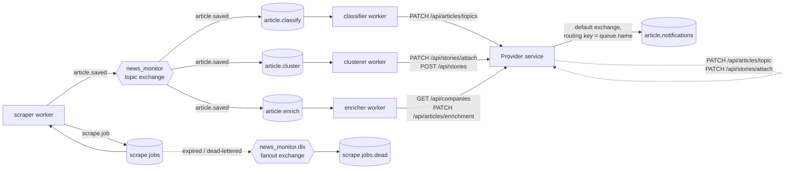

# News Monitor : Complete System Architecture

**News Monitor** is a distributed backend that ingests, classifies and clusters **banking and fintech news** into stories, for an investor-facing app. It started as a generic news monitor and is being transformed step by step (see [`documentation/FINTECH_TRANSFORMATION_PLAN.md`](documentation/FINTECH_TRANSFORMATION_PLAN.md) for the plan and its progress log). The system separates concerns across three independent services : a user-facing manager, a data provider, and a set of Python workers, connected by HTTP and RabbitMQ, each owning its own datastore. This document is the complete, single source of truth for understanding the entire system.

**For detailed API endpoints and schemas, see:** [`PROVIDER_API.md`](documentation/PROVIDER_API.md) and [`MANAGER_API.md`](documentation/MANAGER_API.md).

### Banking / fintech status

| Area | State |
| --- | --- |
| Sources | 27 validated US/UK/EU feeds: trade press, financial news, regulators, central banks ([report](data/source_validation/report.md)). Political-orientation data removed. |
| Topics | 13 banking topics, multi-label with scores: FinBERT fine-tuned on public data + a rule layer for regulator/enforcement content |
| Entities and sentiment | 356 companies (banks, fintechs, regulators, central banks) and 345 tickers. The enricher worker links articles to them, scores FinBERT sentiment per article and per company, and the provider derives Story→Company events with an impact score |
| Market data and charts | Planned: separate Spring Boot `analytics` service |

---

## Architecture Evolution

### Phase 1: Java Monolith with Embedded Threads (The Starting Point)

The system began as a single Spring Boot monolith in Java, connected only to PostgreSQL. The pipeline ran as background threads within the same JVM:

- **One process** bundled everything: user accounts, web APIs, news scraping, classification, and clustering.
- **Thread pool** inside the monolith orchestrated the pipeline stages.
- **PostgreSQL only** : everything (users, articles, classifications, clusters) lived in a single relational database.
- **Two simplistic Python workers** existed but were loosely coupled, handling only basic tasks.

**The problem:** As article volume grew, competing workloads fought for resources. A heavy classification task could starve the web server, and a stuck classification thread could block scraping jobs. Scaling was bottlenecked by the monolith's single process boundary.

### Phase 2: Decoupled Worker Types (Breaking Apart the Threads)

The next iteration realized that scraping, classifying, and clustering were fundamentally different workloads:

- **Three dedicated sraping Java workers** replaced the embedded threads, each in its own process.
- **Shallow scraping** (RSS feed only) was still used since Java libraries for web scraping are limited.
- **REST API python workers** are used for classification and embeddings/clustering.

### Phase 3: Specialized Datastores and Workers(From One to Three)

The current design abandons the monolithic database:

- **Python web scraping** : The former java scrapers were converted to python for true web scraping.
- **RabbitMQ** became the communication backbone: jobs flow through queues, decoupling producer from consumer.
- **RabbitMQ clients** : the former REST API python workers were replaced with RabbitMQ consumers in order to allow async computation.
- **One queue per worker type:** `scrape.jobs` => scraper worker, `article.classify` => classifier worker, `article.cluster` => clusterer worker, `article.enrich` => enricher worker.
- **Fan-out pattern:** the scraper publishes one event (`article.saved`), and a topic exchange fans it to both classification and clustering queues, allowing them to run independently.
- **PostgreSQL** (manager) - user accounts, subscriptions, and notifications. High-consistency relational data.
- **Neo4j** (provider) - articles, sources, topics, and stories.
- **Qdrant** (clusterer worker) - one vector collection holding story centroids. Efficient nearest-neighbor search for clustering decisions.

Vectors and structured data have different access patterns. Embedding 384-dim vectors into Neo4j as properties would be both slow and wasteful. Qdrant's ANN index makes "find the closest story" O(log n) instead of O(n), and its specialized hardware support means clustering stays fast as article volume grows.

**The tradeoff:** No FK constraints across databases. Consistency is maintained at the application layer-each service owns its data and validates foreign references via HTTP before trusting them.

### Why This Arhitecture

1. **User accounts** are central to auth (manager issues all JWTs), so they can't be distributed. PostgreSQL is ideal.
2. **Articles and stories** form a graph (article => topic, article => story, story => article => source). Neo4j models this naturally, SQL would require many JOINs.
3. **Vector similarity search** is the only reason clustering works at all. Qdrant exists because Neo4j's full-text indexes can't do cosine-similarity nearest-neighbor efficiently.

---

## System Overview

### Architectural Decisions

**1. Three independent datastores, one per role**

- Manager owns user accounts (Postgres).
- Provider is system-of-record for articles/stories/topics/sources (Neo4j).
- Clusterer worker owns story vectors (Qdrant).

**2. Provider = single read/write gateway for all structured data**

- Scraper, classifier, clusterer workers never touch Neo4j directly.
- All write operations go through the Provider's REST API, enforcing consistency.
- This is why the Provider is "the news broker".

**3. Async pipeline with RabbitMQ, sync subscription checks**

- **Async:** scraper => classify/cluster/enrich workers (via queues). Scraping never waits for classification.
- **Sync:** user subscribes => manager calls provider to verify the topic/story exists. If provider is down, the subscription fails immediately with a `502`.

**4. Qdrant for vectors only**

- Neo4j has no concept of similarity-based nearest-neighbor search.
- Qdrant's ANN index is the entire reason clustering works: "find the story most similar to this article" is O(log n).
- No text/metadata in Qdrant-just vectors, point IDs, and lightweight payloads. Neo4j is the source of truth for everything else.

---

## Service Details

### Manager Service (Spring Boot + PostgreSQL)

**Role:** User-facing backend. Only service that issues JWTs. Sole owner of the authentication/authorization model.

**Endpoints:**

- `/api/auth/*` - register, login (email+password for users; `systemCode` for services)
- `/api/users/me/*` - account management (read/write own profile, change password)
- `/api/users/{id}/*` - admin operations (list, create, modify, delete users; grant/revoke roles)
- `/api/users/me/subscriptions/*` - subscribe/unsubscribe to topics or stories (manager-side rows; synced with provider)
- `/api/users/me/notifications/*` - list, mark-seen, delete personal notifications

**Database (PostgreSQL):**

| Table             | Purpose                                                                                                     |
| ----------------- | ----------------------------------------------------------------------------------------------------------- |
| `users`         | email, password (BCrypt), name, enabled flag                                                                |
| `user_roles`    | join table linking users to`ROLE_USER` / `ROLE_ADMIN` / `ROLE_SYSTEM`                                 |
| `subscriptions` | per-user subscriptions to topics/stories (cross-service references by ID/name)                              |
| `notifications` | per-user notifications when a subscribed topic/story gets a new article (only written by RabbitMQ consumer) |
| `roles`         | seed rows for the three role types                                                                          |

**RabbitMQ:**

- **Consumes:** `article.notifications` queue only. When the provider publishes that an article matched a subscribed topic/story, this service inserts `Notification` rows for all interested users.
- **Never publishes** to the worker queues.

**Authentication Model:**

- Issues three roles: `ROLE_USER` (human users), `ROLE_ADMIN` (human admins), `ROLE_SYSTEM` (services: manager itself, all workers).
- JWTs are signed with an RSA keypair (`JWT_PRIVATE_KEY_PATH`): manager holds the private key and is the only service that can sign tokens. Provider validates tokens but never issues them, and never has the private key.

---

### Provider Service (Spring Boot + Neo4j)

**Role:** System of record for all structured data (articles, stories, topics, sources, subscriptions). Acts as the single read/write gateway so that consistency is centralized.

**Endpoints:**

- `/api/news-sources/*` - CRUD news sources
- `/api/articles/*` - search, fetch, save articles; tag with topics; trigger scraping
- `/api/stories/*` - list story clusters, create new ones, attach articles
- `/api/topics/*` - list all topics, check topic exists
- `/api/subscriptions/story/{id}` or `/topic/{name}` - track that *someone* is interested (not which user-that's manager's job)

**Database (Neo4j):**


Graph structure (banking/fintech model):

| Node           | Key properties                                                          | Written by                                                       |
| -------------- | ----------------------------------------------------------------------- | ---------------------------------------------------------------- |
| `NewsSource` | name, baseUrl, rssUrl, category, region, paywalled, language, scrapeIntervalMinutes, lastScrapeQueuedAt, failureCount, isDisabled | Seeded by migration (generated by `validate_sources.py`), provider admin API, scraper worker (failure count) |
| `Article`    | author, title, url (unique), bodyText, publishedAt, language, sentimentLabel, sentimentScore | Scraper worker; enricher worker (sentiment) |
| `Company`    | name, lei (unique), country, kind (BANK/FINTECH/REGULATOR/CENTRAL_BANK/OTHER), aliases | Seed migration (company universe) |
| `Ticker`     | symbol, exchange ((symbol, exchange) unique), currency | Seed migration |
| `Topic`      | name (unique)                                                           | Classifier worker                                                |
| `Story`      | title, createdAt, lastUpdated, articleCount, sourceCount, trendingScore | Clusterer worker                                                 |

| Relationship                                  | Meaning                                                                     |
| --------------------------------------------- | --------------------------------------------------------------------------- |
| `Article-[PUBLISHED]->NewsSource`           | Article came from this source                                               |
| `Article-[HAS_TOPIC {score}]->Topic`        | Classifier topic (multi-label), with confidence                             |
| `Article-[MENTIONS {count, salience, inTitle, sentiment}]->Company` | Enricher linked a company mention (Cypher-managed) |
| `Story-[AFFECTS {firstSeen, impactScore}]->Company` | Event: a story about a company (Cypher-managed) |
| `Company-[LISTED_AS {primary}]->Ticker`     | Listing used for price charts                                               |
| `Article-[BELONGS_TO]->Story`               | Clusterer attached this article to this story                               |
| `Subscription-[SUBSCRIBES_TO]->Story\|Topic` | Count of active subscriptions to this story/topic (for notification gating) |

**Authentication:**

- Only validates JWTs (holds manager's RSA public key, never its private key — it can verify signatures but can't forge them).
- All mutating endpoints require `ROLE_ADMIN` or `ROLE_SYSTEM`.
- All read endpoints are public (no auth required).

**RabbitMQ:**

- **Publishes (only):**
  - `scrape.jobs`: triggered by the scheduler (checks every 5 min, queues each enabled source whose own `scrapeIntervalMinutes` has elapsed) or the manual `/api/articles/trigger-scrape` call (all sources).
  - `article.notifications`: published when a subscribed topic/story gets a new article (triggered by workers calling `PATCH /api/articles/topic` or `PATCH /api/stories/{storyId}/attach`).
- **Never consumes** - only a producer.

---

### Workers (Python)

Four independent processes, each consuming from one RabbitMQ queue, calling the Provider's REST API to fetch/write data. All can be scaled horizontally.

#### Scraper Worker

**Consumes:** `scrape.jobs` (one per source per its `scrapeIntervalMinutes`, 15–60 min)

**Datastores:** Neo4j (via Provider), RabbitMQ

**What it does:**

1. Look up the source's RSS/Atom feed URL.
2. Fetch and parse the feed; skip articles already ingested.
3. For each new article: fetch the HTML, extract body text (with multi-strategy fallback: static HTTP => Playwright), save via Provider.
4. After each save, publish `{"url": "...", "source_name": "..."}` to the `news_monitor` topic exchange with routing key `article.saved`.
5. On feed-level failure, increment the source's failure counter and re-queue the job (up to 3 attempts). Individual article failures don't fail the whole job.

**Fetch strategy:**

- Try static HTTP (fast).
- Fall back to browser user-agent if needed (bypasses UA-based blocks).
- Fall back to Playwright headless Chrome (for JavaScript-heavy sites).
- Honor `robots.txt` for every article (including a stricter `Crawl-delay`) and rate limits, retry on transient failures.
- Feeds are parsed with `feedparser` (RSS 0.9x/1.0/2.0, Atom; encodings detected when the server sends no charset).

#### Classifier Worker

**Consumes:** `article.classify` (fanned out from `article.saved`)

**Datastores:** Neo4j (via Provider)

**What it does:**

1. Fetch article title + body from the Provider.
2. Classify title + the opening of the story into one or more of 13 banking topics (multi-label FinBERT; every topic above its tuned threshold, else the single most likely).
   A rule layer (`classifier/rules.py`) then corrects what the public-data model misses: enforcement / financial-crime / supervision wording adds `regulation_legal_enforcement`; deal, earnings, analyst-rating, dividend/buyback and leadership phrases add their topics; a central bank's monetary title (rate decision, QT/APF, MPC) adds `monetary_policy_rates`; and for REGULATOR / CENTRAL_BANK sources a model-assigned `monetary_policy_rates` is kept only when the text is about monetary policy (for regulators it becomes regulation, for central banks it is just dropped). Rules only add or raise topics, need a financial-context term outside financial sources, and are logged per article. `training/eval_rules.py` measures their effect on the public test sets (TFNT macro-F1 0.906 → 0.887, Reuters 0.915 → 0.913). Most of the TFNT drop is taxonomy disagreement: TFNT files bank results under "Financials" (mapped to company news in training), so earnings rules count as false positives there; remapping that class and retraining is the proper fix.
3. Write the scored topics back via `PATCH /api/articles/topics`.

**Model:** `backend/workers/classifier/cls_model_output/` (gitignored; built by `classifier/training/`). Fine-tuned from `ProsusAI/finbert` on public data only (Twitter Financial News Topic + Reuters-21578), with the taxonomy in `training/taxonomy.py` and per-label thresholds in `thresholds.json`. Test scores are in the model's `metrics.json`. Retrain with:

```bash
cd backend/workers/classifier
venv/bin/pip install -r training/requirements.txt
venv/bin/python -m training.prepare_data
venv/bin/python -m training.train --out cls_model_output
```

#### Clusterer Worker

**Consumes:** `article.cluster` (fanned out from `article.saved`)

**Datastores:** Neo4j (via Provider), Qdrant (direct connection).

**What it does:**

1. Fetch article title + body from the Provider.
2. Embed the text with a sentence-transformer model (`all-MiniLM-L6-v2`, 384-dim, cosine distance).
3. Query Qdrant's `story_centroids` for the 5 nearest stories whose articles were **published** within 3 days of this one.
4. Attach to the first candidate that passes the rules in `clusterer/decision.py`: similarity ≥ 0.60; two official releases only if from the same publisher and ≥ 0.75; if both name banks/fintechs, at least one in common. Update the centroid as a running average.
5. **Otherwise:** create a new story and seed its centroid in Qdrant.

**Thresholds:** 0.533 maximised balanced accuracy on 197 SemEval-2022 pairs; 0.60 is nearly the same there (TPR 0.914, TNR 0.815) and removed every thematic false merge on real financial news (see [Clustering Validation Report](#clustering-validation-report)).

---

## Authentication

### Three Roles, One Keypair

All three services key off a single RSA keypair (`backend/keys/jwt-private.pem` / `backend/keys/jwt-public.pem`, signed with RS256). Manager holds both `JWT_PRIVATE_KEY_PATH` and `JWT_PUBLIC_KEY_PATH` — it signs tokens and also validates its own incoming requests. Provider holds only `JWT_PUBLIC_KEY_PATH`: it can verify a manager-issued signature but has no way to produce one itself.

| Role            | Who                                     | Issued by                                                      | Token has                                               |
| --------------- | --------------------------------------- | -------------------------------------------------------------- | ------------------------------------------------------- |
| `ROLE_USER`   | End users                               | Manager`/api/auth/register`                                  | email, user ID, roles claim                             |
| `ROLE_ADMIN`  | Human admins                            | Manager`/api/auth/login` (email+password) + valid admin code | email, user ID, roles claim                             |
| `ROLE_SYSTEM` | All services (manager itself + workers) | Manager`/api/auth/login` with `systemCode`                 | no user identity, subject is literal string`"system"` |

**Manager** (only issuer):

- Generates JWTs on demand, signed with the RSA private key.
- Manager itself gets one `ROLE_SYSTEM` token at boot for outbound calls to provider.
- Each worker process gets its own `ROLE_SYSTEM` token at startup.

**Provider** (validator only):

- Never issues tokens - never even loads the private key.
- On every request, verifies the signature against manager's RSA public key.
- Reads `roles` and `subject` claims straight from the token; no user profile lookup.

**Workers** (pure clients):

- Call manager once at startup: `POST /api/auth/login` with `systemCode`.
- Cache the token on their `requests.Session`.
- On any `401` response from provider (token expired), re-authenticate and retry once.

### Failure Mode: Mismatched Keys

If provider's public key doesn't correspond to manager's private key (stale copy, or the pair was regenerated on one side only):

- Manager's own login endpoints (`/api/auth/*`) work fine (only manager validates its own tokens, with its own key).
- Provider rejects every call from manager or any worker with `401 Unauthorized` (signature verification fails).
- Silent from the outside - manager looks healthy, but data operations silently fail.

---

## Scaling Considerations

### Horizontal Scaling: Workers

Each worker type is stateless-add as many instances as you need:

```bash
# Run 3 scraper instances (load-balanced over scrape.jobs queue)
make scrape-worker &
make scrape-worker &
make scrape-worker &

# Run 2 classifier instances
make classify-worker &
make classify-worker &

# Run multiple clusterer instances (safe — see "Clusterer Locking" below)
make cluster-worker &
make cluster-worker &
```

RabbitMQ automatically distributes messages among consumers. Scraper instances share the load of all `scrape.jobs`. Classifier instances handle `article.classify` in parallel.

### Clusterer Locking (Redis)

Two related races show up once more than one clusterer instance runs, both because "does a matching story exist" and "update its centroid" are read-modify-write decisions against shared state (Qdrant + Neo4j), not atomic operations:

1. **Centroid drift:** two instances both match the same existing story for two different articles at nearly the same moment, both read the same `articleCount`/vector, and both write. She second upsert silently overwrites the first, losing that article's contribution to the centroid.
2. **Duplicate stories:** two instances both process an article for the same brand-new story at nearly the same moment, both find no existing candidate above `SIMILARITY_THRESHOLD` (because neither has written a centroid yet), and both create a separate Story for what should have been one, permanently splitting it. This one is harder to fix with a per-story lock, since there's no story ID to lock on until one of the racing workers has already created it.

**Fix:** a single global lock, held in `handle()` around the whole "query for a candidate, then attach-or-create" decision (`backend/workers/clusterer/clusterer_worker.py`), backed by Redis:

- Keyed by one fixed name, `clusterer:decision-lock` (not per-story, the point is to serialize the *decision* itself, including the "no candidate exists" case), acquired via `redis-py`'s built-in `Redis.lock(...)` (a `SET NX PX`-based mutex with safe, token-checked release — a worker can never release a lock it doesn't hold).
- `CLUSTER_LOCK_TIMEOUT_SECONDS` (default 30) : the lock's own TTL, so a clusterer that crashes mid-decision doesn't leave every future clustering decision permanently blocked; it self-expires and the next attempt can acquire it.
- `CLUSTER_LOCK_BLOCKING_TIMEOUT_SECONDS` (default 15) : how long a waiting instance blocks trying to acquire before giving up; on timeout the handler raises, the message is nacked and requeued (same path as any other processing failure), and whichever instance is free next picks it up.
- The embedding step (the CPU/GPU-bound cost that's the actual reason to run more than one instance) happens *before* the lock is acquired, so it stays fully parallel : only the comparatively cheap "find candidate + attach-or-create" step is serialized across all instances.

Why Redis and not something already in the stack (e.g. Neo4j): a real mutex needs an atomic acquire-or-fail primitive with expiry, which is exactly what Redis's `SET NX PX` gives for free. Emulating it in Neo4j means abusing transactional side effects as a lock and hand-rolling the TTL/crash-recovery logic Redis provides natively — more moving parts for a less obvious guarantee.

## Message Queue Topology: RabbitMQ

### Diagram



`article.notifications` is deliberately **not** attached to the topic exchange - it's isolated so provider's notification messages never accidentally mix with scraper's article-saved events.

### Exchanges and Queues

| Exchange             | Type   | Durable | Purpose                                                                  |
| -------------------- | ------ | ------- | ------------------------------------------------------------------------ |
| `news_monitor`     | topic  | yes     | Fan-out hub. Scraper publishes here; classify/cluster/enrich queues bind to it. |
| `news_monitor.dlx` | fanout | yes     | Dead-letter target for`scrape.jobs` (24h TTL messages land here).      |

| Queue                     | Durable | Binding              | Routing key       | Purpose                                                                                                    |
| ------------------------- | ------- | -------------------- | ----------------- | ---------------------------------------------------------------------------------------------------------- |
| `scrape.jobs`           | yes     | `news_monitor`     | `scrape.job`    | Scraper worker consumes; provider/scraper produce. TTL 24h, dead-letters to`news_monitor.dlx`.           |
| `scrape.jobs.dead`      | yes     | `news_monitor.dlx` | `#`             | Dead-lettered messages (inspection/replay only).                                                           |
| `article.classify`      | yes     | `news_monitor`     | `article.saved` | Classifier worker consumes; scraper produces.                                                              |
| `article.cluster`       | yes     | `news_monitor`     | `article.saved` | Clusterer worker consumes; scraper produces.                                                               |
| `article.enrich`        | yes     | `news_monitor`     | `article.saved` | Enricher worker consumes; scraper produces. |
| `article.notifications` | yes     | (none)               | n/a               | Provider produces; manager consumes.**Not bound to topic exchange** (isolated from scraper fan-out). |

### Message Shapes

**`scrape.jobs`** - One per news source per scrape trigger:

```json
{ "name": "banking-dive", "retry_count": 0 }
```

**`article.classify` / `article.cluster` / `article.enrich`** - Same message, fanned out from `article.saved`:

```json
{ "url": "https://www.bankingdive.com/news/...", "source_name": "banking-dive" }
```

**`article.notifications`** - Published only when subscription exists:

```json
{ "name": "regulation_legal_enforcement", "articleUrl": "https://...", "type": "TOPIC" }
```

or

```json
{ "name": "Regional lender agrees to acquire rival", "articleUrl": "https://...", "type": "STORY" }
```

### Producer & Consumer Summary

| Queue                     | Producer                                                                | Consumer                                  | Condition                                       |
| ------------------------- | ----------------------------------------------------------------------- | ----------------------------------------- | ----------------------------------------------- |
| `scrape.jobs`           | Provider (5-min due-source scheduler + manual trigger), Scraper (re-queue on failure) | Scraper worker                            | Always                                          |
| `article.classify`      | Scraper (fan-out via topic exchange)                                    | Classifier worker                         | Always, after article saved                     |
| `article.cluster`       | Scraper (fan-out via topic exchange)                                    | Clusterer worker                          | Always, after article saved                     |
| `article.enrich`        | Scraper (fan-out via topic exchange)                                    | Enricher worker                           | Always, after article saved                     |
| `article.notifications` | Provider (`ArticleService`, `StoryService`)                         | Manager (`ArticleNotificationListener`) | Only if subscription exists for the story/topic |

---

## Databases

### Why Three Databases?

Originally, everything lived in PostgreSQL. This created three problems:

1. **Relational model can't efficiently express graphs.** Storing "article => topic" and "article => story" requires multiple tables and JOINs. Neo4j's graph model maps directly.
2. **Vector similarity search is O(n) in SQL.** Nearest-neighbor queries for story clustering required full table scans. Qdrant's HNSW index makes it O(log n).
3. **Different consistency guarantees.** User accounts need strong ACID (PostgreSQL). Article classifications can tolerate eventual consistency (RabbitMQ). Vectors don't need relationships at all (Qdrant).

**Solution:** Polyglot persistence. Each service owns a specialized datastore optimized for its job. No FK constraints across databases-consistency lives at the application layer.

### PostgreSQL: Manager's Relational Data

**Database:** `news_monitor` | **Schema:** `users` | **Managed by:** Flyway migrations (`V1`–`V6`)

#### `roles`

| Column   | Type               | Notes                                          |
| -------- | ------------------ | ---------------------------------------------- |
| `id`   | SERIAL PK          |                                                |
| `name` | VARCHAR(50) UNIQUE | `ROLE_USER`, `ROLE_ADMIN`, `ROLE_SYSTEM` |

#### `users`

| Column                          | Type                 | Notes                             |
| ------------------------------- | -------------------- | --------------------------------- |
| `id`                          | BIGSERIAL PK         |                                   |
| `email`                       | VARCHAR(255) UNIQUE  | Login identifier                  |
| `password`                    | VARCHAR(255)         | BCrypt hash                       |
| `name`                        | VARCHAR(255)         | nullable                          |
| `enabled`                     | BOOLEAN DEFAULT TRUE | Disabled users can't authenticate |
| `created_at` / `updated_at` | TIMESTAMPTZ          |                                   |

#### `user_roles`

Join table: `(user_id, role_id)` composite PK, both FKs cascade on delete.

#### `subscriptions`

| Column         | Type           | Notes                                          |
| -------------- | -------------- | ---------------------------------------------- |
| `id`         | VARCHAR(36) PK | UUID                                           |
| `user_id`    | BIGINT FK      | CASCADE on delete                              |
| `type`       | VARCHAR(20)    | `TOPIC` or `STORY`                         |
| `target_id`  | VARCHAR(255)   | Topic name or Story ID (no FK-stored in Neo4j) |
| `created_at` | TIMESTAMPTZ    |                                                |

Unique constraint on `(user_id, type, target_id)` - enforces "can't subscribe twice to the same thing."

#### `notifications`

| Column         | Type                  | Notes                                              |
| -------------- | --------------------- | -------------------------------------------------- |
| `id`         | VARCHAR(36) PK        | UUID                                               |
| `user_id`    | BIGINT FK             | CASCADE on delete                                  |
| `message`    | VARCHAR(1000)         | e.g.,`"New article for TOPIC 'regulation_legal_enforcement': <url>"` |
| `seen`       | BOOLEAN DEFAULT FALSE |                                                    |
| `created_at` | TIMESTAMPTZ           |                                                    |

Index on `(user_id, seen)` for unseen-notification queries. Only written by `ArticleNotificationListener` - never via HTTP.

### Neo4j: Provider's Graph Data

**Single graph database, no schemas.** Schema and seed data come from Cypher migrations in `backend/neo4j/migrations/`, applied automatically when the container starts:

| Migration | Content |
| --- | --- |
| `V1__baseline_schema` | Constraints and indexes (squashed from the old generic-news V1–V9) |
| `V2__seed_banking_sources` | 27 validated sources (generated by `scraper/tools/validate_sources.py`) |
| `V3__company_ticker_schema` | Company / Ticker / Story constraints, company-name fulltext index, AFFECTS indexes |
| `V4__seed_banking_topics` | The 13 banking topics (must match `classifier/training/taxonomy.py`) |
| `V5__seed_company_universe` | 356 companies and 345 tickers (generated by `enricher/tools/build_universe.py`) |
| `V6__drop_issuer_entities` | Removes SEC filers that are subsidiaries/note issuers of curated companies (seeded by an earlier V5 build; no-op on fresh databases) |

#### Nodes

| Label            | Key properties                                                          | Constraints                                                                                              |
| ---------------- | ----------------------------------------------------------------------- | -------------------------------------------------------------------------------------------------------- |
| `NewsSource`   | name, baseUrl, rssUrl, category, region, paywalled, language, scrapeIntervalMinutes, lastScrapeQueuedAt, failureCount, isDisabled | `name` UNIQUE, `rssUrl` UNIQUE, index on `baseUrl` |
| `Article`      | author, title, url, bodyText, publishedAt, language, sentimentLabel, sentimentScore | `url` UNIQUE, indexes on `publishedAt`/`author`/`title`, fulltext index on `[title, bodyText]` |
| `Topic`        | name                                                                    | `name` UNIQUE                                                                                          |
| `Story`        | title, createdAt, lastUpdated, articleCount, sourceCount, trendingScore | `id` UNIQUE, index on `lastUpdated`, fulltext index on `[title]` |
| `Company`      | name, lei, country, kind, aliases | `id` UNIQUE, `lei` UNIQUE, indexes on `name`/`kind`, fulltext index on `[name, aliases]` |
| `Ticker`       | symbol, exchange, currency | `(symbol, exchange)` UNIQUE, index on `symbol` |
| `Subscription` | count                                                                   | Existence checked via relationship (no unique properties)                                                |

**Every node's `id` is an app-generated UUID string** (via `UuidStringIdGenerator`), persisted as a real property. This matters: Spring Data Neo4j's default ID generator only tracks Neo4j's internal element ID, which breaks custom Cypher that matches on `{id: $x}`. Without it, story attachment would silently fail because there's no `id` property to match.

#### Relationships

```
(:NewsSource)-[:PUBLISHED]->(:Article)
(:Article)-[:HAS_TOPIC {score}]->(:Topic)                         // multi-label
(:Article)-[:BELONGS_TO]->(:Story)
(:Article)-[:MENTIONS {count, salience, inTitle, sentiment}]->(:Company)   // Cypher-managed
(:Story)-[:AFFECTS {firstSeen, impactScore}]->(:Company)                   // Cypher-managed
(:Company)-[:LISTED_AS {primary}]->(:Ticker)
(:Subscription)-[:SUBSCRIBES_TO]->(:Story | :Topic)
```

A `Subscription` node tracks "someone is interested in this"-it has no link to *which* user, only a `count`. Per-user identity lives in manager's Postgres `subscriptions` table. Provider only needs to know whether to publish a notification (boolean).

### Qdrant: Clusterer Worker's Vector Store

**Single collection:** `story_centroids` | **Access:** Clusterer worker only | **Vector model:** `sentence-transformers/all-MiniLM-L6-v2` (384-dim, cosine distance, normalized)

#### Collection Schema

| Field                    | What                                                       |
| ------------------------ | ---------------------------------------------------------- |
| Point ID                 | Same UUID string as the Story's`id` in Neo4j             |
| Vector                   | 384-dim, unit-normalized (cosine similarity = dot product) |
| Payload:`storyId`      | Redundant copy of point ID (for convenience)               |
| Payload:`articleCount` | Weights the running-average centroid update                |
| Payload:`lastUpdated`  | Datetime of the last attach (indexed; informational)       |
| Payload:`firstPublishedAt` / `lastPublishedAt` | Publish-date span of the story's articles (indexed; powers the date window) |
| Payload:`sources` / `officialOnly` | Publishers so far / whether all are regulators or central banks |
| Payload:`companies` | Bank/fintech company ids linked in the story's articles (company guard) |

#### Usage Pattern

1. **Attach to existing story:** Query `story_centroids` for the nearest centroids whose `firstPublishedAt`/`lastPublishedAt` span is within `STORY_WINDOW_DAYS` of the article's publish date; accept the first that passes `clusterer/decision.py`. Update centroid as running average.
2. **Create new story:** No candidates found-create story in Neo4j first (to get ID), then seed centroid point in Qdrant with that ID.

### Cross-Database References (By Convention)

No enforced foreign keys; each string agreement is application-level:

| Value          | Source               | Referenced in                                                                                  |
| -------------- | -------------------- | ---------------------------------------------------------------------------------------------- |
| Topic name     | Neo4j`Topic.name`  | Postgres`subscriptions.target_id`                                                            |
| Story`id`    | Neo4j`Story.id`    | Postgres`subscriptions.target_id`, Qdrant point ID                                           |
| Article`url` | Neo4j`Article.url` | Worker messages (`article.classify`/`article.cluster`/`article.enrich` payloads), `article.notifications` |

**Consistency failure is soft:** if a manager subscription points to a deleted story, provider's `existsByStoryId` returns `false` and no notification is published. No database error.

---

## Workers: The Python Processing Pipeline

**Location:** `backend/workers/` | **Shared modules:** `provider_client.py` (HTTP client), `retry.py` (backoff), `env_config.py` (env vars), `log_config.py` (logging)

Four independent RabbitMQ consumers (scraper, classifier, clusterer, enricher), each in its own Python venv with its own `requirements.txt`.

### Provider-Outage Handling

All workers wrap message handling in `call_with_retry()`:

- Retries up to 5 times on `ProviderError` (transport failure or unexpected status).
- Backoff: 60s, 120s, 180s, 240s between attempts.
- Uses `connection.sleep()` (not `time.sleep()`) to keep RabbitMQ heartbeat alive.
- **On 5th failure:** nack message back to queue (`requeue=True`), shut down worker via `stop_consuming()`.

Any other exception is logged and the message is nacked for requeue; worker keeps running.

### Scraper Worker

**Consumes:** `scrape.jobs` (one per source per its `scrapeIntervalMinutes`) | **Publishes:** `scrape.jobs` (re-queue on failure), `article.saved` (on every saved article) | **Run:** `make scrape-worker`

**What it does:**

1. Get source config (RSS URL, base URL, disabled flag) from Provider.
2. If disabled: one attempt only-success re-enables it (`reset_failures`), failure keeps it disabled (no re-queue).
3. If enabled: fetch and parse RSS feed, skip already-ingested URLs, for each new entry:
   - Skip it if `robots.txt` disallows the URL for our user agent.
   - Fetch HTML via `SmartFetcher` (multi-strategy fallback below).
   - Extract body text with `TrafilaturaExtractor`.
   - Save via `POST /api/articles`.
   - Publish `{"url": "...", "source_name": "..."}` to `article.saved`.
4. On feed failure: increment failure counter, re-queue job with incremented `retry_count` (up to `SCRAPE_MAX_ATTEMPTS` = 3).

**Fetch strategy (`SmartFetcher`)** - tries in order until extracting ≥ `JS_MIN_CHARS`:

1. Static HTTP with bot user-agent - fast, works for most sites.
2. Static HTTP with browser user-agent - bypasses UA-based blocks (e.g., CBC, NPR).
3. Headless Chromium via Playwright in a **fresh subprocess** (`playwright_fetch_worker.py`) - pika's blocking connection runs its own asyncio loop, and two asyncio setups in one process were breaking Playwright's dispatcher after long uptime.

`TrafilaturaExtractor` strips cookie/consent-banner lines and rejects pages left with under 150 characters (some Bank of England document pages extract as nothing but the cookie banner; their content is a PDF). `HttpFetcher` honors `Retry-After` on HTTP 429 (capped by `MAX_RETRY_SLEEP`), fetches `robots.txt` with timeout, and fails **open** (allow) on error-a `robots.txt` hiccup never silently kills a source.

**Key env vars:**

- `SCRAPE_MAX_ATTEMPTS` - re-queue cap per job.
- `RSS_BROWSER_UA_SOURCES` - comma-separated sources whose feed needs the browser UA (none of the current banking sources do; empty is fine).
- `USER_AGENT` / `BROWSER_USER_AGENT` - bot vs. browser identities.
- `RATE_LIMIT_SECONDS` - delay between requests to same source.
- `JS_LOAD_WAIT_MS` / `JS_MIN_CHARS` - Playwright wait time and extracted-text threshold.

#### Validating and seeding sources

Sources are not hand-picked into the database. Candidates live in `data/source_candidates.json`; the validator checks each one the way the scraper will fetch it and only seeds those that pass:

```bash
cd backend/workers
scraper/venv/bin/python -m scraper.tools.validate_sources                 # validate + report
scraper/venv/bin/python -m scraper.tools.validate_sources --write         # + regenerate data/sources.json and V2 migration
scraper/venv/bin/python -m scraper.tools.validate_sources --reuse-report --write   # re-apply rules without network calls
```

Checks: feed reachable and parseable (with feed discovery from the homepage and common paths), freshness, items per day (sets `scrapeIntervalMinutes` to 15/30/60), `robots.txt`, body extraction with the production fetch chain, paywall markers, and banking relevance. Verdicts: `PASS` (seeded), `HEADLINE_ONLY` (paywalled or unextractable; not seeded, since the scraper drops body-less articles), `FAIL`. The validator does not try to get around bot protection or paywalls. Results: `data/source_validation/report.md`.

### Classifier Worker

**Consumes:** `article.classify` (fanned out from `article.saved`) | **Run:** `make classify-worker`

**What it does:**

1. Fetch article title + body from Provider (`GET /api/articles/by-url`). Drop if not found.
2. Classify title + the first 600 characters of the body (max 64 tokens, as in training) with the multi-label `NewsClassifier`; keep every topic above its tuned threshold, else the top one.
3. Apply the rule layer (`classifier/rules.py`) using the source's category, looked up once per source.
4. Write the scored topics back via `PATCH /api/articles/topics`, logging any rules that fired.

**Topics:** `earnings_results`, `m_and_a_investments`, `monetary_policy_rates`, `regulation_legal_enforcement`, `debt_capital_markets`, `dividends_buybacks`, `analyst_ratings`, `leadership_personnel`, `fx_currencies`, `macro_economy`, `markets_stock_moves`, `company_product_news`, `other`.

**Model:** `cls_model_output/` (gitignored, about 440 MB): config with `id2label`, tokenizer, `label2id.json`, `thresholds.json`, `metrics.json`. Override the path with `CLASSIFIER_MODEL_DIR`. Loads lazily via `NewsClassifier.get_instance()`. Training data is public only, so its scores on our own articles are not measured yet (needs hand labels).

| Held-out test | Model only | Model + rules |
| --- | --- | --- |
| Twitter Financial News, macro-F1 | 0.906 | 0.887 |
| Reuters-21578, macro-F1 | 0.915 | 0.913 |

```bash
classifier/venv/bin/python -m unittest discover -s classifier/tests -t .   # rule tests
classifier/venv/bin/python -m classifier.training.eval_rules               # rule impact on public test sets
```

### Enricher Worker

**Consumes:** `article.enrich` (fanned out from `article.saved`) | **Run:** `make enrich-worker` | **Setup:** `cd backend/workers && make setup-enricher`

**What it does:**

1. Load the company universe from `GET /api/companies` at startup; reload every `UNIVERSE_REFRESH_MINUTES` (60), or at once if the provider rejects a company id.
2. Fetch the article; link company mentions with the shared `entity_linker.py` (also used by the clusterer) (dictionary of names + aliases, no NER model):
   - acronyms and camel-case brands (SEC, ING, BofA) match case-sensitively;
   - brands that are ordinary words or places (Chase, Block, Affirm, Wise, Halifax) match case-sensitively and only with financial context;
   - names shared by two companies, and names made only of generic words ("Bancorp, Inc."), are skipped;
   - names made only of common English words ("Northern Trust", "Citizens Bank") match case-sensitively, and are skipped unless they contain a corporate word (so "Financial Institutions" / "First National" never match ordinary prose);
   - salience: 0.6 for a title mention, +0.25 if named in the lead, +0.1 per mention (max 1).
3. FinBERT sentiment (`ProsusAI/finbert`, sentence level): article = 0.5 × title + 0.5 × mean of the first lead sentences; company = weighted mean of the sentences naming it (title counts double); label = FinBERT's most likely class.
4. `PATCH /api/articles/enrichment` with sentiment and mentions. The provider replaces the article's `MENTIONS` and refreshes the events of its story.

**Concurrent writes:** story attach, topic writes and enrichment all touch a story's events. The provider runs each as one transaction via `Neo4jWrites` (retry outside, transaction inside, retried on Neo4j transient errors such as deadlocks) and takes the story's lock first, writing companies and topics in sorted order, so concurrent writers queue instead of deadlocking. If retries are exhausted the API answers 503 (retry later) instead of 500.

**Events** (`(:Story)-[:AFFECTS]->(:Company)`): derived by the provider (`EventService`) whenever an article is enriched, joins a story, or gets new topics, so the order in which the workers finish does not matter. Properties: `firstSeen` (earliest article), `articleCount`, `sentiment`, and `impactScore` in [0, 1] = 0.25 × breadth (sources / 5) + 0.15 × coverage (mentioning articles / 3) + 0.20 × strongest salience + 0.25 × topic weight (enforcement and M&A 1.0, earnings 0.8, FX 0.3, ...) + 0.15 × |sentiment| + 0.10 if a regulator or central bank published part of the story; capped at 1.

**Key env vars:** `ARTICLE_ENRICH_QUEUE`, `SENTIMENT_MODEL`, `UNIVERSE_REFRESH_MINUTES`.

```bash
enricher/venv/bin/python -m unittest discover -s enricher/tests -t .   # linker tests on the real universe
```

### Company Universe (input for the enricher)

`enricher/tools/build_universe.py` builds the entities that articles will be linked to:

- **US banks** from SEC data: NYSE/Nasdaq companies with bank SIC codes 6021, 6022, 6029, 6035, 6036 (uses the SEC-required identifying `USER_AGENT` from `.env`).
- **Curated** (`data/company_universe_curated.json`): large US banks with display names and aliases, fintechs, UK/EU banks, regulators and central banks. Curated US tickers are checked against the SEC file.
- SEC filers named after a curated company (subsidiaries and note issuers, e.g. Barclays Bank PLC, which files for iPath ETNs) are skipped.
- **LEIs** from GLEIF, exact legal-name matches only (unmatched stay empty rather than risk a subsidiary's LEI).

```bash
cd backend/workers && enricher/venv/bin/python -m enricher.tools.build_universe
```

Writes `data/company_universe.json`, the generated `V5__seed_company_universe.cypher` and `data/company_universe_report.md` (items to review).

### Clusterer Worker

**Consumes:** `article.cluster` (fanned out from `article.saved`) | **Datastores:** Neo4j (via Provider), Qdrant (direct) | **Run:** `make cluster-worker`

**What it does:**

1. Fetch article title + body from Provider. Drop if not found.
2. Embed `"{title}\n\n{body_text}"` (truncated to `MAX_EMBED_CHARS` = 4000 to avoid quadratic attention memory) with `ArticleEmbedder` singleton (`sentence-transformers/all-MiniLM-L6-v2`, 384-dim, normalized).
3. Link bank/fintech mentions with the shared `entity_linker.py` (same linker as the enricher; company universe from `GET /api/companies`) and look up whether the source is a regulator/central bank.
4. Query Qdrant `story_centroids` for the `CLUSTER_CANDIDATES` (5) nearest stories whose publish-date span is within `STORY_WINDOW_DAYS` (3) of the article.
5. Take the first candidate `clusterer/decision.py` accepts, in similarity order:
   - **date window:** the article's publish date is within 3 days of the story's first/last article;
   - **threshold:** similarity ≥ `SIMILARITY_THRESHOLD` (0.60); if article and story are both official releases, the same publisher and ≥ `OFFICIAL_SIMILARITY_THRESHOLD` (0.75);
   - **company guard:** if both name banks/fintechs, at least one in common.

   Rejected candidates are logged with the reason. Attach via Provider and update the centroid as a running average (weighted by `articleCount`); Qdrant first (idempotent upsert-by-ID).
6. **Otherwise:** create new story via Provider first (server-generated ID), then seed centroid in Qdrant.

`ensure_collection()` runs on startup - idempotent, creates `story_centroids` and its datetime payload indexes (`lastUpdated`, `firstPublishedAt`, `lastPublishedAt`) if needed.

```bash
clusterer/venv/bin/python -m unittest discover -s clusterer/tests -t .   # decision rules (cases from real articles)
```

**Rebuilding stories** after changing the rules: with the provider and a cluster worker running, `make recluster` deletes all stories and events plus the Qdrant centroids and re-queues every article oldest first (`clusterer/tools/requeue.py`). Articles, topics, mentions and sentiment are kept; events are rebuilt as articles rejoin stories.

**Key env vars:**

- `QDRANT_URL` / `QDRANT_API_KEY` - Qdrant connection.
- `EMBEDDING_MODEL_NAME` / `EMBEDDING_DIM` - model choice and vector size.
- `SIMILARITY_THRESHOLD` - base attach cutoff (0.60).
- `OFFICIAL_SIMILARITY_THRESHOLD` - cutoff for two official releases, same publisher required (0.75).
- `STORY_WINDOW_DAYS` - publish-date window around a story's articles (3).
- `CLUSTER_CANDIDATES` - nearest stories considered (5).
- `MAX_EMBED_CHARS` - input truncation (4000 chars).
- `CENTROID_COLLECTION` - collection name (`story_centroids`).
- `REDIS_URL` - global clustering decision lock backend (see "Clusterer Locking" under Scaling Considerations).
- `CLUSTER_LOCK_TIMEOUT_SECONDS` / `CLUSTER_LOCK_BLOCKING_TIMEOUT_SECONDS` - lock TTL and acquire-wait timeout.

### Clustering Validation Report

**Data:** SemEval-2022 Task 8 (Multilingual News Article Similarity), English-English pairs only. 197 usable pairs after Internet Archive fetch failures (116 same-story, 81 different-story).

**Models tested:**

| Model                                      | Params | Balanced accuracy | TPR (same-story) | TNR (different-story) |
| ------------------------------------------ | ------ | ----------------- | ---------------- | --------------------- |
| `Qwen/Qwen3-Embedding-0.6B`              | 0.6B   | **90.8%**   | 94.0%            | **87.7%**       |
| `sentence-transformers/all-MiniLM-L6-v2` | 22M    | 88.0%             | **95.7%**  | 80.2%                 |

**Threshold selection:** Balanced accuracy maximized at **0.533** (for MiniLM). Tradeoff: MiniLM is ~27x smaller (faster per-article embedding) but ~3 points less accurate. Qwen3 is better at rejecting unrelated pairs (TNR 87.7% vs 80.2%), which is preferable if false merges are costly.

**Caveats:**

- Text truncated at 4000 chars before embedding (original model max is 32768 tokens). Loss of signal for stories diverging deep in long articles.
- Extraction noise: trafilatura sometimes pulled boilerplate instead of article body (worth broader spot-check before trusting threshold as final).
- Dataset: 2020-era COVID news, English-only.

**Re-validation on financial news** (140 real articles from the first live run; full notes in [`CLUSTERING_VALIDATION.md`](documentation/CLUSTERING_VALIDATION.md)):

| | Old rules (5-day processing window, 0.533) | Guards + 0.533 | Guards + 0.60 (current) |
| --- | --- | --- | --- |
| Stories | 48 | 120 | 129 |
| Biggest story | 21 articles | 7 | 6 |
| Stories spanning > 3 days | 12 (max 111 days) | 0 | 0 |
| Thematic false merges in multi-article stories | most | 6 (0.534–0.584) | 0 found |

The old rules built topical "mega-stories" (21 sets of minutes in one story; every Fed/BoE/ECB monetary release in another), which inflated events: Citigroup's top event came from an ECB speech story (0.695; now 0.534), HSBC's from a minutes story (0.682; now 0.367).

---

## Authentication & Authorization Model

### Three Roles, One Keypair

All three services key off a single RSA keypair (`backend/keys/jwt-private.pem` / `backend/keys/jwt-public.pem`, RS256). Manager is the sole issuer and holds both keys; provider only validates and holds just the public key.

| Role            | Who                                    | Issued by                                                      | Contains                                               |
| --------------- | -------------------------------------- | -------------------------------------------------------------- | ------------------------------------------------------ |
| `ROLE_USER`   | End users                              | Manager`/api/auth/register`                                  | email, user ID, roles claim                            |
| `ROLE_ADMIN`  | Human admins                           | Manager`/api/auth/login` (email+password + valid admin code) | email, user ID, roles claim                            |
| `ROLE_SYSTEM` | Services: manager itself + all workers | Manager`/api/auth/login` with `systemCode` (no password)   | no user identity; subject = literal string`"system"` |

**Manager's bootstrap:** On startup, `SystemTokenProvider` generates one `ROLE_SYSTEM` token directly (not via HTTP), signed with the RSA private key loaded from `JWT_PRIVATE_KEY_PATH`. Stamped onto all outbound calls to provider via `RestTemplate` interceptor.

**Each worker's bootstrap:** `ProviderClient` calls manager `/api/auth/login` with `{"systemCode": "..."}`, caches token on `requests.Session`, re-authenticates transparently on `401` response.

### Endpoint-Level Access Matrix

**Manager endpoints:**

- `/api/auth/*` - public (no token required).
- `/api/users/me/*` - authenticated (any valid JWT; scoped to caller's own email via JWT subject).
- `/api/users/{id}/*` - `ROLE_ADMIN` only.
- `/api/users/me/subscriptions/*` - authenticated.
- `/api/users/me/notifications/*` - authenticated.

**Provider endpoints:**

- All `GET` - public (no token required).
- All `POST`/`PUT`/`PATCH`/`DELETE` - `ROLE_ADMIN` or `ROLE_SYSTEM` (varies by endpoint).

### Failure Mode: Mismatched Keys

If provider's public key (`JWT_PUBLIC_KEY_PATH`) doesn't match manager's private key:

- Manager's own login/register work fine.
- Every call from manager or worker to provider fails `401 Unauthorized` (signature verification fails).
- Silent from outside - manager looks healthy, but data operations fail silently.

---

## Running the System

### Prerequisites

- Docker + Docker Compose v2 (`docker compose version`)
- To run manager/provider outside Docker: JDK 21 + Maven (`export JAVA_HOME=$(/usr/libexec/java_home -v 21)`; Lombok fails to compile on JDK 25)
- To run workers outside Docker: Python 3.11 (`brew install python@3.11`). The workers Makefile uses `/opt/homebrew/bin/python3.11` by default; override with `make setup PYTHON=...`. The macOS Command Line Tools Python 3.9 crashes when launching the Playwright helper processes.
- The classifier model is not in git: train it once (see [Classifier Worker](#classifier-worker)) before running the classifier or building its image.

### One-Time Setup

```bash
make env   # copies env.example → .env (skipped if .env already exists)
```

Generate the JWT signing keypair. manager signs tokens with the private key, provider only ever holds the public key (see [Authentication](#authentication)):

```bash
mkdir -p keys
openssl genpkey -algorithm RSA -out backend/keys/jwt-private.pem -pkeyopt rsa_keygen_bits:2048
openssl pkey -in backend/keys/jwt-private.pem -pubout -out backend/keys/jwt-public.pem
```

Both files are gitignored (`backend/keys/.gitignore`) — generate your own per environment, never commit them.

### Two Ways to Run It

**A. Manual dev (infra in Docker, apps run yourself)** — the default:

```bash
make dev   # env + up (infra only) + migrate + rabbitmq-setup
```

This starts only neo4j/rabbitmq/postgres/redis as containers. Run each app yourself in its own terminal, from its own directory (all read the root `.env`):

```bash
cd backend/manager  && mvn spring-boot:run    # http://localhost:9000/manager
cd backend/provider && mvn spring-boot:run    # http://localhost:8080/news-provider

cd backend/workers && make setup              # one-time: builds a venv per worker type
cd backend/workers && make scrape-worker      # also: classify-worker, cluster-worker, enrich-worker
```

**B. Fully containerized** — manager, provider, and several replicas of each worker (3 per worker type, 2 enrichers) also run as containers (all named `news-mm-*`):

```bash
make up-full
```

Both workflows share the same infra containers and `.env`. `make up-full`'s services only start under Compose's `apps` profile, so `make up`/`make dev` never pull them in by accident.

### Accessing Manager & Provider

| Service  | Base URL                                | Health               | Swagger UI           |
| -------- | --------------------------------------- | -------------------- | -------------------- |
| Manager  | `http://localhost:9000/manager`       | `/actuator/health` | `/swagger-ui.html` |
| Provider | `http://localhost:8080/news-provider` | `/actuator/health` | `/swagger-ui.html` |

Seeded admin login (from `AdminSeeder` — override via `APP_ADMIN_*` in `.env`):

```bash
curl -X POST http://localhost:9000/manager/api/auth/login \
  -H "Content-Type: application/json" \
  -d '{"email":"admin@example.com","password":"Admin123!"}'
```

Use the returned `token` as `Authorization: Bearer <token>` against provider's `ROLE_ADMIN`/`ROLE_SYSTEM`-protected endpoints.

### Makefile Reference

Run `make help` for the full, always-current list. The ones you'll reach for most:

| Target                                    | What it does                                                                                                                     |
| ----------------------------------------- | -------------------------------------------------------------------------------------------------------------------------------- |
| `make dev`                              | Bootstrap infra:`.env`, infra containers, migrations, RabbitMQ setup                                                           |
| `make up` / `make up-full`            | Start infra only / infra + manager + provider + all workers                                                                      |
| `make down`                             | Stop everything that's running                                                                                                   |
| `make ps`                               | Show container status                                                                                                            |
| `make logs`                             | `SERVICE=<name>` to filter; also `logs-manager`, `logs-provider`, `logs-scraper`, `logs-classifier`, `logs-cluster`, `logs-enricher`  |
| `make migrate`                          | Re-apply Neo4j migrations (idempotent — already-applied ones skip)                                                              |
| `make rabbitmq-setup`                   | Re-run RabbitMQ topology setup (idempotent)                                                                                      |
| `make neo4j-shell` / `rabbitmq-shell` | Open an interactive shell into that container                                                                                    |
| `make clean`                            | Stop everything and delete all volumes —**destructive**                                                                   |
| `make *-purge`                          | Wipe a specific datastore's data (`neo4j-purge`, `postgres-purge`, `qdrant-purge`, `purge-dbs`) — **destructive** |

Neo4j migrations and RabbitMQ topology setup both run automatically the moment their container starts (see `backend/neo4j/entrypoint-wrapper.sh` and `backend/rabbitmq/entrypoint-wrapper.sh`) — the `make migrate`/`make rabbitmq-setup` targets above are for re-running them by hand (e.g. a new migration file appeared) without restarting the container.

## Reliability & Failure Modes

### Provider Down (Structured Data Unavailable)

- **Workers:** Retry 5 times with backoff (60s, 120s, 180s, 240s). On 5th failure: nack message, shut down.
- **Manager=>Provider calls:** Surface as `502 ExternalServiceException` to client.
- **Effect:** Scraping, classification, clustering all queue up but stall. Once provider recovers, RabbitMQ redelivers and pipeline resumes.

### Manager Down (Auth Unavailable)

- **New worker:** Fails at startup when authenticating.
- **Running worker with valid token:** Keeps working until token expires (24h default). Once expired, next `401` from provider triggers re-auth attempt. If manager still down, worker shuts down.
- **Users:** Login, register, subscription, notification endpoints return `5xx`.

### RabbitMQ Down (Pipeline Stops)

- **Scraper:** Can't publish `article.saved` => articles saved to Neo4j but not classified/clustered.
- **Workers:** Can't consume => articles sit in queue.
- **Notifications:** Can't reach manager => no user notifications.

### Neo4j Down (System Stops)

- Provider can't read/write => all worker calls fail.
- User subscriptions fail (sync call from manager).
- Nothing works until Neo4j recovers.

### Qdrant Down (Clustering Only)

- Clusterer can't query/update centroids => stalls.
- Scraper and classifier keep working (don't touch Qdrant).
- Pipeline partially degraded: articles scraped/classified but not clustered.

## Summary

**News Monitor evolved from a monolithic Java process with embedded threads to a distributed, polyglot system.**

The separation forced responsibilities: **manager** handles auth and user state; **provider** is system-of-record for articles/stories/topics; **workers** are pure processing clients. RabbitMQ decouples the pipeline (scraping doesn't block classification). Three specialized datastores (PostgreSQL for relational data, Neo4j for graph structure, Qdrant for vector search) replaced one generalist database, trading cross-database FK constraints for flexibility and performance.

The result: a system that scales each component independently, isolates failures (provider down ≠ clustering down), and optimizes each layer for its job. New articles flow through scraping => classification => clustering as independent asynchronous jobs. Subscribed users are notified the moment an article matches their interests. Adding new sources, tweaking the classifier, or tuning the embedding threshold requires no full-system redeploy-each worker type is independent and can restart in isolation.
