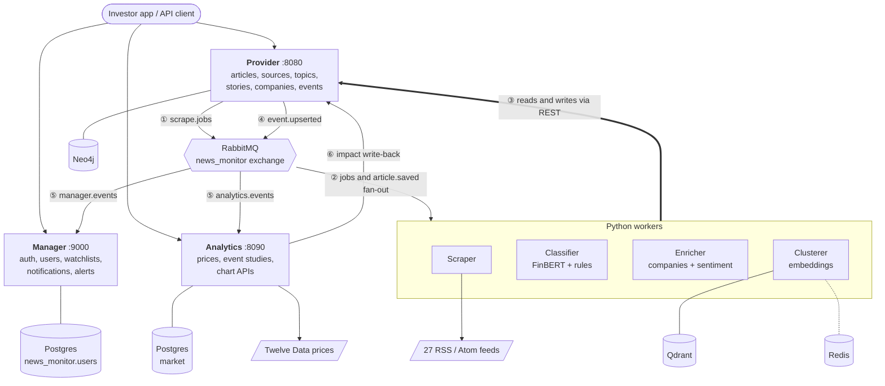
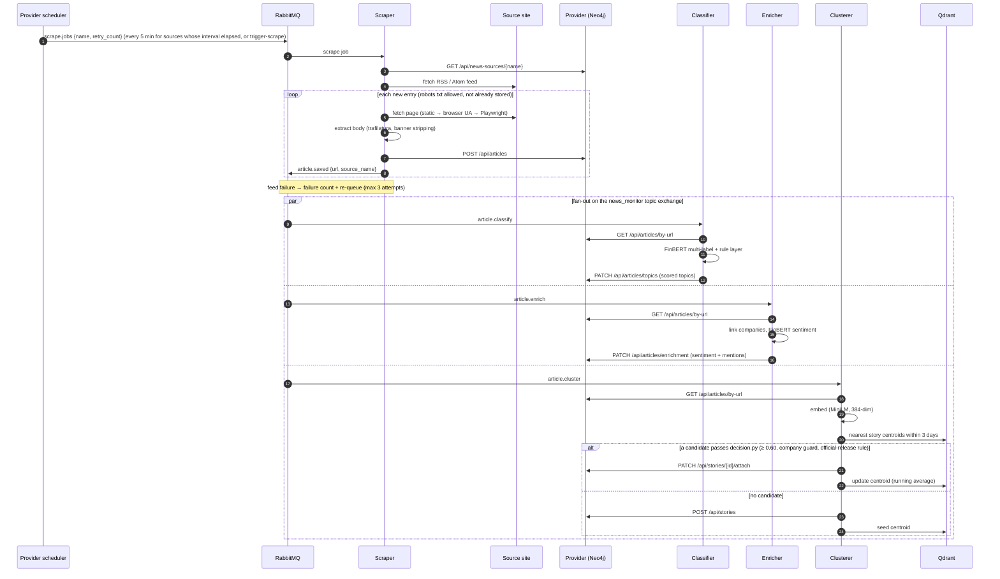
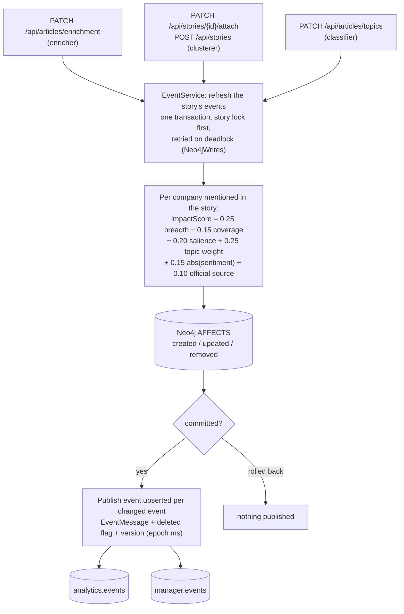
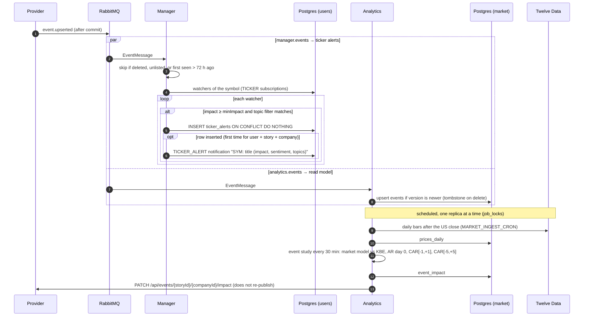
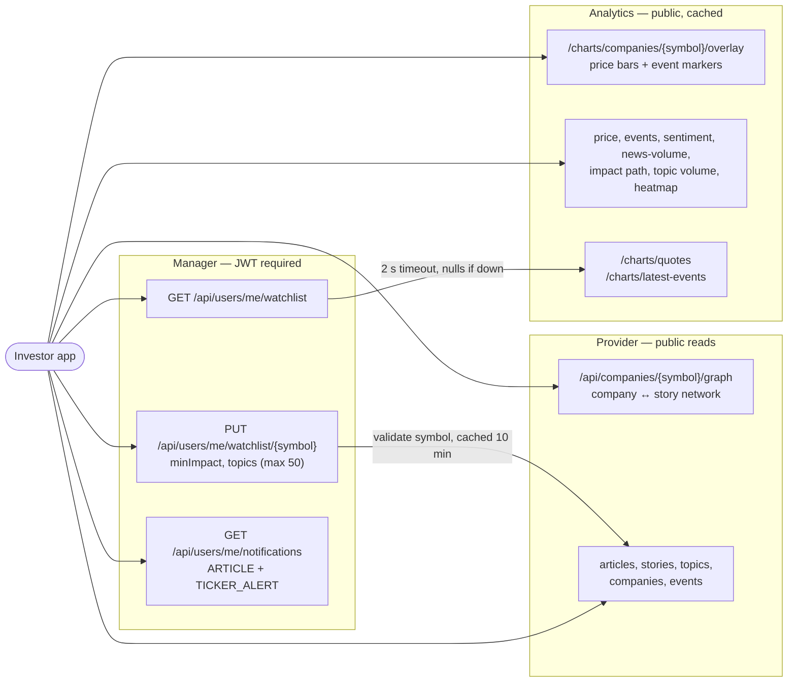
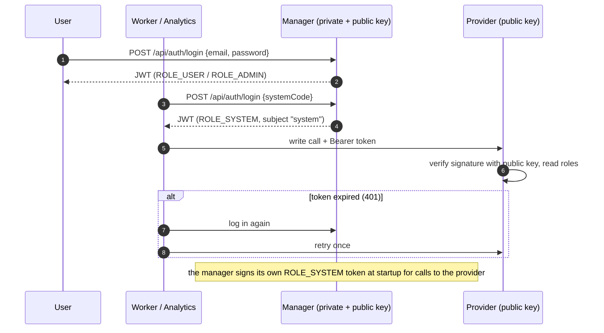
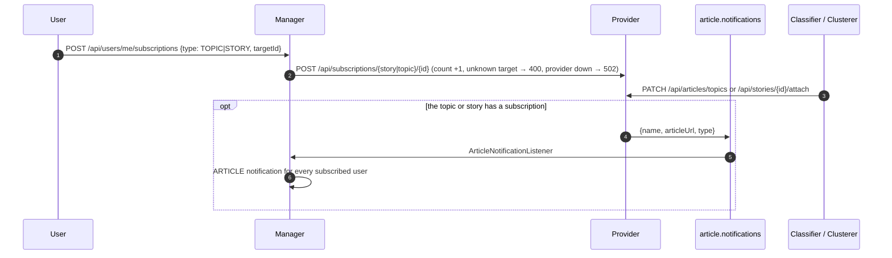

# System Flow

How data moves through the banking/fintech news backend, from a feed item to an investor's chart and alert. The diagrams are Mermaid (rendered by GitHub and most Markdown viewers). Component details live in the [README](../README.md); endpoints in [PROVIDER_API.md](PROVIDER_API.md), [MANAGER_API.md](MANAGER_API.md) and [CHARTS_API.md](CHARTS_API.md).

1. [System overview](#1-system-overview)
2. [Article pipeline: feed to story](#2-article-pipeline-feed-to-story)
3. [Events: from articles to Story→Company events](#3-events-from-articles-to-storycompany-events)
4. [Event consumers: alerts and market analytics](#4-event-consumers-alerts-and-market-analytics)
5. [Investor read paths](#5-investor-read-paths)
6. [Authentication](#6-authentication)
7. [Topic and story notifications](#7-topic-and-story-notifications)

---

## 1. System overview

Three Spring Boot services and four Python workers. Every service owns its datastore; nothing reads another service's database. Workers write only through the provider's API (the clusterer also owns Qdrant).

① the provider queues a scrape job per due source · ② the scraper saves articles and publishes `article.saved`, which fans out to the classifier, enricher and clusterer · ③ every worker reads and writes only through the provider · ④ the provider publishes every changed Story→Company event · ⑤ analytics and the manager consume it (charts, ticker alerts) · ⑥ analytics writes event-study results back. Service-to-service reads (manager → provider/analytics for the watchlist, analytics → provider for its event feed) are in [§5](#5-investor-read-paths) and [§4](#4-event-consumers-alerts-and-market-analytics).

| Store | Owner | Holds |
| --- | --- | --- |
| Neo4j | Provider | Sources, articles, topics, stories, companies, tickers, events (`AFFECTS`) — the system of record |
| Postgres `news_monitor` (schema `users`) | Manager | Users, roles, subscriptions and watchlists, notifications, alert dedup |
| Postgres `market` | Analytics | Event read model, daily prices, event studies, company names, job leases |
| Qdrant | Clusterer | One centroid vector per story |
| Redis | Clusterer | Global lock around the attach-or-create decision |

---

## 2. Article pipeline: feed to story

A scrape job per source, then one `article.saved` message fanned out to three independent workers. They finish in any order; the provider merges their results.

Worker failure handling: a provider outage is retried 5 times with backoff (60–240 s), after which the message is requeued and the worker stops; any other error requeues the message and the worker carries on.

---

## 3. Events: from articles to Story→Company events

An **event** is `(:Story)-[:AFFECTS {firstSeen, impactScore, articleCount, sentiment}]->(:Company)`. The provider recomputes a story's events whenever any of the three workers writes, so the result does not depend on which worker finishes first.

`version` makes consumers order-independent: an older or duplicate message never overwrites a newer one, and a removal leaves a tombstone.

---

## 4. Event consumers: alerts and market analytics

The same `event.upserted` message feeds two independent consumers.

Recovery: `POST /analytics/api/admin/events/rebuild` replays the provider's `GET /api/events` into the read model; messages for a stopped manager or analytics wait in their durable queues.

---

## 5. Investor read paths

---

## 6. Authentication

The manager is the only token issuer (RS256, private key). Provider and analytics hold only the public key. Services log in with a shared `systemCode` and get `ROLE_SYSTEM`.

Reads on the provider and analytics are public; writes need `ROLE_ADMIN` or `ROLE_SYSTEM`. Everything under the manager's `/api/users/**` needs a token.

---

## 7. Topic and story notifications

The older, article-level notifications (subscriptions to a topic or a story) use a separate direct queue, not the topic exchange.

